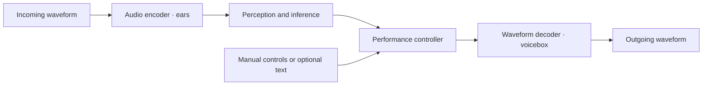

# Jaeger Lyra

**An experimental audio-native framework for hearing, expressive control, and voice generation.**

**R&D alpha 0.1 — `v0.1.0-alpha.1`.** This snapshot preserves the working reconstruction prototype for later research. No further model development is scheduled as part of this release.

The final alpha 0.1 handoff is on `master` and `alpha/0.1`; the original `v0.1.0-alpha.1` tag is preserved. See the [project page](https://jenkinsrobotics.github.io/JaegerLyra/) and [release notes](docs/releases/0.1.0-alpha.1.md).

The working demo demonstrates **reconstruction playback**. Lyra's waveform decoder rebuilds captured speech from saved continuous acoustic controls, with adjustable pitch, volume, resonance, brightness, pace and vibrato.

It does **not** yet create arbitrary new sentences, understand incoming speech, or clone a voice from a short sample. Those are research goals for the wider framework.

## What you are hearing

```text
Offline preparation
Kokoro-generated recording → acoustic encoder → saved continuous controls

Live reconstruction playback
saved controls → performance controls → Lyra waveform decoder → audio
```

Kokoro generated the reference recordings and supplied synthetic training audio for the current experimental model. **Kokoro's model is not loaded during Lyra reconstruction playback.** The live path also does not replay the source WAV; it decodes the saved acoustic representation. Those controls retain detailed information from the captured performance, so successful reconstruction is different from independently generating new speech.

The two A/B players compare a **Kokoro source recording** and a **Lyra reconstruction** at matched loudness. The separate **Reconstruct phrase live** button runs Lyra's decoder with the current voice-character controls. A/B recordings remain fixed for comparison.

## Run the demo

**macOS is a primary platform.** The alpha is locally verified on macOS 26 with Apple Silicon, and CI covers macOS ARM64 alongside Linux. Intel Mac compatibility has not yet been verified.

Python **3.11 or 3.12** and a recent browser are required. Node.js is only needed for the browser-audio tests. The prepared demo bundle is included; no external model download, avatar app, account or API key is needed.

```bash
git clone https://github.com/JenkinsRobotics/JaegerLyra.git
cd JaegerLyra
python3.11 -m venv .venv
source .venv/bin/activate
python -m pip install -r requirements.txt
python -m jaeger_lyra --port 8794
```

Open **http://127.0.0.1:8794/**. Audio starts only when you press a playback button.

- **Reconstruct word:** three captured voices, six words each; every word finishes automatically.
- **Hold a note:** an explicit sustained-vowel mode. A/S/D/F/G/H/J/K select notes; **Finish word** plays the captured ending. Escape stops playback.
- **Voice character:** resonance and brightness change spectral colour; pace changes duration independently of pitch; vibrato varies pitch. These are experimental transformations, not anatomical vocal-tract controls or proven voice matching.
- **Reconstruction comparison:** nine phrases with source/reconstruction labels that can be revealed.
- **Reconstruct phrase live:** streams decoded audio in small packets. This is streaming a prepared performance, not streaming a new sentence from text.

An optional **two-voice singing study** appears above the instrument when local duet assets are prepared. It uses Kokoro natural speech preparation, followed by Lyra neural decoding and an authored pitch/timing score. The two dry vocal tracks play as independent sources on one clock, with separate mute/volume controls; the player does not use a merged recording. It is playback of prepared hybrid voices, not independent Lyra text-to-singing. User media and the supplied song lyrics remain local and are not part of the bundled alpha. See [the duet workflow](docs/DUET_DEMO.md).

## The intended framework

Your proposed process is the direction of the project. The usual names are an **encoder** on the input side and a **decoder** on the waveform-output side:



| Part | Responsibility | Current state |
| --- | --- | --- |
| **Ears / audio encoder** | Preserve acoustic information in a continuous representation. | Offline acoustic encoding exists. Robust live perception is planned. |
| **Perception / inference** | Extract meaning, speaker cues, intent, timing and context from audio. | Planned. Existing prediction experiments do not establish speech understanding. |
| **Performance controller** | Decide what sound to produce and how it unfolds over time. | Manual controls and captured timing work. Independent content and articulation generation are planned. |
| **Voicebox / waveform decoder** | Turn the acoustic control trajectory into waveform samples. | Working reconstruction and controlled resynthesis prototype. |

The goal is direct audio-to-audio operation without a mandatory transcript bottleneck. Continuous learned representations still count as representations; “audio-native” does not mean that only raw PCM may exist internally. Text can remain an optional interface. Predictive coding and local energy-based learning are research directions, not a demonstrated end-to-end learning solution.

See [architecture](docs/ARCHITECTURE.md), [current status](dev/docs/reality/STATUS.md) and [roadmap](dev/docs/roadmap/README.md).

## Repository layout

| Path | Contents |
| --- | --- |
| `jaeger_lyra/` | Source-checkout demo entry point. |
| `voice-research/live_voicebox/` | Local server, browser demo, streaming runtime and integration tests. |
| `voice-research/audio_native/` | Neural decoder, encoders, DSP/control experiments, training/evaluation scripts and numerical tests. |
| `demo/bundle/` | Self-contained, hash-checked decoder, prepared controls and synthetic comparison recordings. |
| `voice-research/FOUNDATION.md` | Preserved chronological research notes; historical names/paths remain as evidence. |
| `scripts/` | Experiment preparation, comparison tools and bundle packaging. |
| `licenses/` | Original model/data/dependency provenance and notices. |
| `evidence/`, `models/`, `voice-tools/` | Local research archive and optional external reference engines; deliberately not versioned in Git. |
| `docs/template-reference/` | Preserved Jaeger template examples; not Lyra's implementation. |

The imported root-level Kokoro, cloning and singing adapters are **optional legacy comparison infrastructure** still used by the avatar client. The Lyra reconstruction demo does not import them. JaegerOS slot integration is planned; this repository does not currently claim a working JaegerOS module or depend on a JaegerOS runtime.

[Preview the local reconstruction demo](docs/assets/lyra-reconstruction-demo.jpg).

## Verify

```bash
# Validate every included demo file, run numerical/runtime tests and browser PCM tests.
python -m pip install -r requirements-dev.txt
python scripts/verify.py

# With the local server running and idle: silent HTTP checks (no speaker playback).
python voice-research/live_voicebox/check_words.py
python voice-research/live_voicebox/check_shapes.py
```

The verifier also checks that phrase vibrato has an effect, neutral phrase reconstruction remains faithful, and the runtime loads without any Kokoro/MLX/PyTorch model imports. Timing measurements describe computation and browser delivery separately; they are not acoustic latency guarantees. Listening acceptance and new-speech quality need their own evaluation.

## Research assets and provenance

The initial local migration preserved the research history, downloaded reference models and environments, with links from the former avatar project. Those large archives are ignored by Git; the included demo bundle is sufficient for a fresh checkout. See [migration notes](docs/MIGRATION.md) and [data provenance](docs/DATA_PROVENANCE.md).

To intentionally rebuild the prepared demo from the local research archive:

```bash
python scripts/package_demo.py
```

This packages existing recordings and controls and performs offline pulse analysis. It does not train weights or generate new Kokoro audio. Historical experiments may need the separately recorded research environments and external models; they are not all dependencies of the demo.

## License

Project code follows the repository's [Apache-2.0 license](LICENSE). Third-party tools, model weights and datasets retain their own terms; see [provenance](docs/DATA_PROVENANCE.md) and the records in `licenses/`. This research does not claim strict clean-room provenance or an independently sourced speech corpus.
