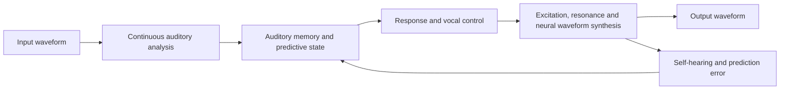
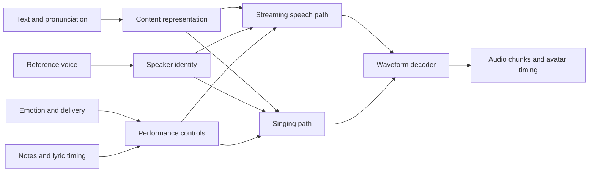

# Aether Voice — research foundation

Decision record · November 6–7, 2026. This is a proposed engine direction with small trained research components, not a completed speech/singing engine or an Aether app migration.

Build an independent voice engine whose acceptance standard is the clean, natural English delivery the user liked in Kokoro Heart. Keep one character identity across conversational speech, expressive acting and singing. Make streaming, interruption and precise performance controls part of the design from the beginning.

## User direction update: continuous audio ears and voice

**Current stopping scope:** the user's revised goal is to bring the **output voicebox** to the preferred Kokoro level, then stop this phase. Listening, auditory understanding and input-side learning are deferred. Teacher-audio encoding is evaluation infrastructure for the output experiments, not progress on an input understanding system. Stop only after output quality is supported by held-out measurements and listening comparison; correct ASR, fast decoding or an invertible waveform representation alone does not establish Kokoro parity.

**November 7 priority clarification:** first establish the capacity of a **neural waveform generator** driven by a continuous matrix of vocal/sound controls. It should reconstruct the complexity of unseen Kokoro audio before further work on the network that chooses new speech content. One shared generator should eventually cover many voice identities. Learned columns are not automatically phonemes, articulators or identity factors; those interpretations need intervention tests. Retaining original PCM/residual, or performing a full invertible transform, proves a reconstruction path but not a learned voice generator or novel speech. The first neural capacity study below separates its control encoder, decoder-only inference, linear reconstruction reference and later control generation. No discrete phoneme/audio vocabulary is required.

### User correction: words must finish automatically · November 7

The user found the playable widget's voice acceptable but objected to its intentional indefinite vowel sustain during ordinary word playback. Default speech behavior now advances through the complete word automatically. This is a product correction, not evidence of new voice-model quality parity.

`prepare_words.py` encodes all 18 original naturally timed word recordings into a separate bundle, with only quiet edge trimming and 20 ms padding. Existing extended-vowel fixtures remain solely for explicit **Hold a note** mode. Default **Play word** reconstructs every sample in order; preselected pitch changes use the existing pulse-synchronous performance stream without changing duration. The server completes the word at its actual end, independently of browser timers or release commands. Mid-word pitch edits are reserved for hold mode; volume and Stop work during ordinary playback.

All 18 word HTTP streams automatically complete and match their offline decoded samples, with natural durations of **0.417–0.618 seconds**. Three additional pitched Palm streams retain the exact source sample counts, while explicit sustain remains active until release. Eight runtime tests and six JavaScript audio tests pass. Browser checks of Heart/Palm at native pitch and +3 semitones completed without Finish word, with zero observed underruns; output was muted. The user’s positive widget feedback does not establish acceptance of all A/B reconstructions or custom singing/cloning. The voice quality goal remains unproven and the studio's Kokoro default is unchanged.

### Moving resonance control on fresh diphthongs · November 7

`resonance_morph.py` adds a continuous spectral-articulation experiment over the existing neural captured-grain source. Two captured envelopes and their three estimated resonance landmarks define a frequency-warped interpolation path. A causal, time-varying minimum-phase FIR reshapes one excitation instead of mixing two independently colored waveforms. The filter has 511 samples of history, no future-sample requirement, and samplewise coefficient interpolation; the source retains its separate 20 ms waveform delay. The envelope ratio is clamped before profile-energy normalization, which is not a final peak limiter. This is project DSP around the frozen neural decoder, not a newly trained neural vocoder, a physical vocal tract or an independent phoneme learner. [Spectral-envelope morphing research](https://www.isca-archive.org/interspeech_2005/ezzat05_interspeech.html) motivates frequency correspondence; this code does not reproduce its audio-flow algorithm.

The study captures **27 new Kokoro word recordings** across Heart, Michael and Bella. Development words “eye,” “ow,” and “oy” fit endpoint profiles and monotonic timing curves; held-out words are “high,” “sigh,” “how,” “cow,” “boy,” and “toy.” Initial fixed eight-period endpoint windows were too short for the six higher-pitched development cases. Before any held-out rendering, capture was repaired to retain at least 80 ms with pitch-adaptive pulse support. The initial three captures and six failures remain under `capture-attempt-1/`, with the change recorded in `capture-repair.json`. All nine revised captures succeed. Endpoint analysis uses external WORLD envelopes and Praat formants. Three nine-value timing curves are fitted by monotonic grid search on development spectra, not neural training or predictive coding.

Each held-out word supplies its nucleus duration, pulse-derived pitch and RMS trajectory to every candidate, explicitly isolating spectral articulation rather than learning prosody or new pronunciation. The candidate waveform uses development captures, not the target waveform. Four combinations of waveform blending versus moving resonances and linear versus fitted timing produce **72 renders**. After inspecting these results, a separately labelled **18-render oracle diagnostic** supplies the full reference spectral envelope to the same excitation/filter path. It is not independent generalization.

| Condition | Median transition spectrum error, dB | Dual pitch checks / 18 | Nearest source voice / 18 | Median same-nucleus cosine |
| --- | ---: | ---: | ---: | ---: |
| Kokoro reference | 0.000 | 12 | 14 | 1.000 |
| Neural reconstruction | 0.092 | 12 | 13 | 0.996 |
| Waveform blend, linear path | 5.231 | 6 | 12 | 0.336 |
| Waveform blend, fitted path | 5.342 | 6 | 14 | 0.323 |
| Moving resonances, linear path | 4.964 | 7 | 10 | 0.314 |
| Moving resonances, fitted path | 5.279 | 6 | 7 | 0.287 |
| Full reference envelope diagnostic | 3.389 | 4 | 14 | 0.705 |

The spectral metric compares mean-centered STFT band energies over 100–6000 Hz, within the central half of each nucleus. It is distinct from the WORLD envelope used to fit controls, but is not a naturalness score. The moving-resonance linear path improves **13/18** individual cases over the linear blend, with median paired change **−0.248 dB**. Fitted timing does not establish a consistent improvement; its median paired identity change is worse. The oracle envelope improves spectrum in all 18 cases (median paired **−1.948 dB**) and same-nucleus embedding cosine, while losing pitch coverage. Six original teacher nuclei also fail the strict dual-tracker gate, so pass counts must not be read as perceptual judgments. ECAPA anchors exclude the evaluated diphthong family and all held-out words; short nuclei remain outside ordinary speaker-evaluation conditions.

Direct neural reconstruction on these eighteen fresh nuclei has **39.92 dB median waveform SNR**, reinforcing the distinction between detailed waveform reproduction and generating compact, natural articulation. The oracle result indicates that full envelope information helps considerably, while leaving a substantial gap. It does not isolate whether the remaining loss arises from the captured excitation, its repetition, the phase response of the time-varying filter, or the envelope estimator. The next controlled comparison should keep the reference envelope and excitation fixed while comparing minimum-phase and fixed-delay linear-phase filtering.

Five new signal tests cover moving peaks, exact endpoint profiles, identity/convolution behavior, immediate controls, bounded history, cancellation, empty finish, invalid-input atomicity and the full-envelope diagnostic. **163 research tests pass**. The largest measured block is **5.77 ms**, with one over the 5 ms budget; preparation, transport and devices are excluded. Fifteen of the ninety experimental/oracle clips contain samples beyond full scale (maximum **1.588**). Shared initial-carrier peaks occur across multiple methods, so the filter is not the sole cause. The float originals remain intact; audition files use a single disclosed equal-RMS gain, without clipping or limiting, and peak at most **0.646**.

Evidence is in `evidence/resonance-morph/v1/summary.json`, with all **126 matched clips and 19 plots** linked from [the articulation study](http://127.0.0.1:8791/voicebox-resonance-lab.html). Every packaged hash was verified; the first Heart “high” comparison plot was visually reviewed. Browser selection and seven comparison players were checked without playback. The user reported they have not yet listened, so listening acceptance remains open. No quality replacement or Kokoro parity is declared; Kokoro Heart remains the default, and input understanding stays deferred.

### Playable live output and natural-speech reconstruction · November 7

The existing frozen decoder now has a standalone playable browser instrument at **http://127.0.0.1:8794/**, implemented under `voice-research/live_voicebox/`. It supports immediate pitch/volume changes, captured onset → held vowel → captured ending, early-release queuing, Stop/Escape and natural-speech reconstruction comparisons. The 18 units reuse the corrected syllable fixtures. Nine natural speech phrases reuse the earlier validation recordings; this is an integration test, not new held-out quality evidence or new neural training.

The loopback server decodes 5 ms blocks from saved controls and transports 20 ms PCM packets. The browser uses an AudioWorklet, 40 ms initial buffering, bounded storage and short playback fades. Captured-unit synthesis also has a fixed 20 ms waveform delay. All nine HTTP phrase streams match offline reconstructions within **4.36e−8**, and controls sent after streaming starts reproduce exactly when replayed at their recorded application samples. Stop and disconnect clear sessions. Five Python and six JavaScript tests pass; the unchanged core's preceding 158-test result remains separately recorded. All 18 comparison WAV hashes are verified.

Browser checks used an explicit zero-gain live monitor, with no audible or autoplay testing. Changing notes, keyboard control, release, natural speech and Escape worked. Observed first packets were **38 ms** for the first held-voice check and **30 ms** for natural speech, with no observed underruns. These checks exclude physical output latency and do not establish robustness across devices. Under the HTTP check, 12 compute blocks exceeded 5 ms; the maximum was **8.49 ms**. No hard real-time guarantee is claimed. A stale final queue readout found during review was corrected to show an empty queue after drain/Stop.

Natural-speech reconstruction SNR is **32.91 dB median** over the nine phrases. The renderer still depends on dense captured waveform controls, not a learned compact collection of vocal articulators. The next quality milestone is natural new transitions and connected output with stable identity, assessed on fresh material and through listening. Reconstructing a supplied waveform does not establish the ability to choose controls for unseen speech. The user's notes → vowels → syllables curriculum remains useful; breath, consonants and timing must be tested alongside periodic notes. Human source generation and articulation involve multiple structures ([NIDCD](https://www.nidcd.nih.gov/news/multimedia/how-does-human-body-produce-voice-and-speech-text-version)); [DDSP](https://arxiv.org/abs/2001.04643) provides precedent for neural control of interpretable synthesis components, not proof of our engine or learning rule.

Evidence is in `evidence/live-voicebox/v1/summary.json`, `http-check.json`, test logs and browser screenshots. The app default remains Kokoro Heart. Listening acceptance, Kokoro parity, compact controllable generation and general short-reference cloning remain unproven. Input understanding stays deferred.

### Held-grain width ablation · November 7

`NeuralGrainWindowStream` isolates window width while keeping the source, pulse centers, held-span selection, note schedule and neural decoder unchanged. The default delegates to the established minimum(source period, target period) rule. Two alternatives use the adjacent source period, or 1.5 times that period, for held grains only. Prefix/release grains retain the original rule. Each half-window is capped at 479 samples to fit the existing 20 ms delay and bounded buffers; **no grain hits the cap on this source panel**. There is no post-render gain compensation or pitch correction.

The study reuses the same 18 corrected synthetic sources and adds **144 renders**, compared with 72 established neural/PCM controls plus 72 teacher/reconstruction references. These are development results, not fresh-source validation. The entire saved waveform outside the held span plus a disclosed **20 ms guard** is exactly unchanged in every candidate. Four new tests verify exact default compatibility, coherent periodic reconstruction at native pitch, preservation of outside context during a pitch change, and finite/bounded behavior at the 60 Hz source / 800 Hz control extreme. **158 research tests pass**.

| Neural held-window rule | Both pitch checks / 36 | Word matches / 36 | Nearest source voice / 36 | Median source-anchor cosine |
| --- | ---: | ---: | ---: | ---: |
| Minimum source/target period | 36 | 23 | 29 | 0.328 |
| Source period | 36 | 22 | 30 | 0.332 |
| 1.5 × source period | 33 | 23 | 31 | 0.332 |

Group medians do not establish a paired identity improvement: median paired cosine change is approximately −0.000005 for source-period windows and +0.00116 for wider windows. The wider neural failures are Michael's “paw” and “raw” melodies and Bella's “raw” melody. All have detected-frame p95 errors under 50 cents, but Praat voicing coverage is 84.8%, 65.4% and 82.6%, respectively. WORLD largely retains voicing and the requested pitch. These failures are estimator disagreement under the frozen combined check, not proof of silent audio or an audible wrong note. The original-PCM comparator also loses four wide-window pitch passes (36 → 32/36), with word matches unchanged at 19/36. No threshold or time window is relaxed.

A frozen, gain-normalized 80-band log-mel diagnostic compares each steady note to its corrected teacher over independent hold+100 ms through release−100 ms. It uses 1,024-sample Hann windows, a 120-sample hop and 2,048 FFT, spanning 80–8,000 Hz. The median absolute shape difference is **0.818 dB baseline, 0.819 dB source-period and 1.076 dB wider** for the neural conditions. Median held RMS ratios to the teacher are nearly unchanged (about −0.017 dB). These are spectral diagnostics, not naturalness or identity ratings. Neural/PCM paired output SNR remains approximately 42 dB under all three rules.

Across the 72 new neural cases, first-packet compute is **0.80 ms median**, maximum packet compute **1.28 ms**, with no packet over 5 ms. Waveform delay remains a separate **20 ms**, excluding capture, loading, transport and devices. Maximum tested grain radius is 348.8 samples; cache size remains bounded at 7,680 waveform samples, while source controls retain 115,885 scalars. All candidates are finite and below full scale (maximum 0.480), and end/cancel clears pending state.

Evidence is in `evidence/neural-syllables/grain-windows-v1/summary.json`, with **144 new ASR evaluations**, 144 reused evaluations and 108 native spectral comparisons. All **306 matched clips, 36 plots and 18 labelled reels** are retained. Source/output hashes and plot headers were verified. The Heart “calm” native spectrum and Michael “paw” melody plot were visually reviewed; the latter separates the methods and explicitly marks unvoiced frames so overlapping curves cannot hide coverage failures. Audition peak is at most 0.831 and loudness error below 7e−8 LU. No audio was autoplayed.

Decision: retain the minimum-period renderer as the established reference. The alternatives remain available for research, with no promoted quality winner. The next concrete deliverable is a playable live waveform instrument and natural-speech reconstruction comparison, preserving the accepted Kokoro app default. Listening, actual audio-device latency, fresh-source generalization and Kokoro-level output quality remain unverified. Input understanding remains deferred.

### Separating original context from the controlled vowel · November 7

`NeuralContextStream` tests whether retuning the entire voiced opening and ending contributes to the previous identity/word losses. It preserves the independently decoded prefix, release, or both, using fixed **30 ms cosine fades** into/out of the existing renderer. The held middle remains unchanged. Preserved context keeps captured pitch, so these policies intentionally limit where note commands apply. The three policies, source list, fade duration, decoder and existing pitch thresholds were frozen before rendering.

On the same 18 corrected synthetic sources, the study adds **216 renders** to 72 earlier neural/PCM controls, plus 36 teacher and 36 reconstruction references. It is a development ablation, not fresh-source validation. All 216 candidate renders preserve the selected context within **1.49e−8 maximum sample error**; every sample in the unaffected region matches the saved baseline exactly. Four new tests cover voiced context, unchanged held interiors, independently selectable policies, pending output after release, bounded cache/cleanup and invalid fades. **154 research tests pass**.

| Neural controller | Both pitch checks / 36 | Word matches / 36 | Nearest source voice / 36 | Median source-anchor cosine |
| --- | ---: | ---: | ---: | ---: |
| Retune all voiced context | 36 | 23 | 29 | 0.328 |
| Preserve opening | 36 | 22 | 29 | 0.341 |
| Preserve ending | 36 | 21 | 30 | 0.338 |
| Preserve both | 36 | 22 | 29 | 0.344 |

The median **paired** cosine change for preserving both is only +0.0045; the difference between group medians is not that paired effect. That policy gains two word matches and loses three. In the separate original-PCM comparator, preserving both gains four word matches without a loss (19 → 23/36), while retaining 36/36 pitch passes. These inconsistent ASR effects prevent a blanket pronunciation claim. All 216 new ASR results and 144 reused evaluations remain in the report. The common teacher pitch interval still excludes 80 ms at each edge and includes preserved source spans; a generic inherited metric description was clarified without changing any numerical result or threshold.

The fixed fades introduce small additional envelope dips. For the neural both-context condition, the median change in minimum-to-median local RMS is −0.28 dB at the opening join and −0.17 dB at release; worst paired changes are −2.40 and −2.71 dB. This exploratory diagnostic uses 20 ms RMS windows every 5 ms within 100 ms either side of each boundary. It is not a perceptual pass threshold. The Heart “calm” plot visibly shows the short dips; exact source preservation outside a fade does not prove an inaudible join.

Across 108 new neural renders, first-packet compute is **0.84 ms median**, maximum packet compute **1.30 ms**, with no packet over 5 ms. The independent waveform delay remains **20 ms**; preparation, loading, transport and audio devices are excluded. The cache remains within 7,680 waveform samples, but each source still retains 115,885 control scalars. All outputs are finite and below full scale (maximum 0.4801); cancellation/end clears pending state. Neither compact articulatory control nor a new pronunciation model has been learned.

The study is in `evidence/neural-syllables/context-v1/summary.json`, with all **378 level-matched clips, 36 raw-envelope plots and 18 labelled reels** in `audition/`. Every source/output hash and plot header was verified; the Heart “calm” held-note plot was visually reviewed. Audition sample peak is at most 0.831 and loudness error below 5e−8 LU. No audio was autoplayed. These context policies remain optional research controls, with no promoted quality winner and no app-default change.

Next, isolate the held-vowel resynthesis itself. The current grain half-window uses the smaller adjacent source/target period, consistent with the documented [Praat overlap-add algorithm](https://www.fon.hum.uva.nl/praat/manual/overlap-add.html); it is not an identified implementation bug. Alternative window/phase choices can be tested as explicit hypotheses about timbre, keeping the original-PCM comparison and validating any chosen change on fresh sources. The [original PSOLA paper](https://courses.physics.illinois.edu/ece420/fa2021/5_PSOLA.pdf) describes spectral and phase consequences of the analysis window. These references motivate an experiment, not a claim that an alternative will improve our output. Kokoro quality, perceived identity and general voice cloning remain unaccepted; input understanding stays deferred.

### Digital voicebox curriculum and independent syllable transfer · November 7

The user's proposed sequence—waveform reproduction, notes, changing speech sounds, then complete utterances—is a useful engineering curriculum. It does not establish that our learning algorithm models human development. The intended compact interface should separate pitch, intensity, excitation/breath, vocal resonance and articulation over time; phonemes can serve as test labels without requiring a discrete vocabulary in the synthesis path. A chord can be rendered with several simultaneous voice instances; single-voice harmonics, stable vowels and natural transitions are more informative early tests. Related source/filter and learned signal-control approaches include [DDSP](https://magenta.tensorflow.org/ddsp), [neural source-filter synthesis](https://arxiv.org/abs/1904.12088) and [HiFi-Glot](https://arxiv.org/abs/2409.14823). These establish relevant research directions, not the performance of our implementation or an alternative learning rule.

`transfer_kokoro_syllables.py` freezes the existing independent decoder and compares the prior uncorrected versus corrected/gain-compensated pretrained references. **72 complete clips** are encoded, saved, reopened and reconstructed without loading Kokoro at independent inference. Median waveform SNR is **40.18 / 39.55 dB** for the two variants; minima are 26.54 / 26.38 dB. The linear inverse reference remains somewhat better at 41.34 / 40.73 dB median. Reconstructed clips retain the teacher's pitch-pass counts, but this is detailed waveform reconstruction, not a compact physical voice model or newly learned pronunciation.

`NeuralSyllableStream` extends the existing onset/hold controller with an immediate release command. Before release it sustains captured vowel detail indefinitely; after release it resumes the encoded source's ending at native timing. Voiced sections follow supplied pitch, while unvoiced codas keep their decoded source timing. Release is idempotent, invalid early release is rejected, and cancellation clears pending state. An analytic voiced-tail test exposed and fixed a one-period dropout at the final pulse boundary. Four new tests cover compatibility, voiced/unvoiced tails, release validation and bounded state; the complete research suite passes **150 tests**.

Offline capture uses known teacher pitch and hold annotations. **35/36 units** pass the frozen period-stability rule; uncorrected Bella “true” fails and is retained in the denominator. The benchmark renders both held notes and melodies through the neural controller and a separately labelled, lossless original-PCM controller: **140 eligible renders of 144 planned**. No synthesis thresholds are changed after seeing the results.

| Source variant and method | Available / planned | Both pitch checks | Word matches | Nearest source voice |
| --- | ---: | ---: | ---: | ---: |
| Uncorrected teacher | 36 / 36 | 19 | 18 | 31 |
| Uncorrected reconstruction | 36 / 36 | 19 | 16 | 31 |
| Uncorrected live neural | 34 / 36 | 26 | 13 | 25 |
| Uncorrected live PCM | 34 / 36 | 26 | 14 | 26 |
| Corrected teacher | 36 / 36 | 34 | 24 | 32 |
| Corrected reconstruction | 36 / 36 | 34 | 24 | 32 |
| Corrected live neural | 36 / 36 | 36 | 23 | 29 |
| Corrected live PCM | 36 / 36 | 36 | 19 | 29 |

The summary also reports all methods on the same 17 eligible source identities, avoiding an unequal-source comparison between variants. Pitch checks retain the prior common teacher interval and require both Praat/WORLD to find at least 95% voiced frames with p95 error at most 50 cents. The interval includes the source prefix before the independent hold and the start of release. ASR is an isolated-word diagnostic, not a naturalness rating. All **212 new ASR evaluations**, plus 72 reused teacher evaluations, are retained.

Across 70 paired live conditions, neural output differs from the same controller with original PCM by **42.69 dB median SNR** (minimum 26.17 dB). Both controllers lose speaker-embedding similarity: corrected teacher median source-anchor cosine is 0.353, versus 0.328 neural / 0.334 PCM. Anchors exclude both ordinary-source words with the same intended vowel class. ECAPA is speech-trained, not validated here for singing quality; this tradeoff needs listening. Similar losses in the lossless controller suggest that decoder capacity alone will not resolve the articulation/identity problem. No direct teacher-versus-live waveform SNR is used, because independently resynthesized excitation can differ in phase.

Independent first-packet computation is **0.76 ms median**, with maximum measured packet time **1.23 ms** across the 70 neural cases and no packet over its 5 ms budget. There is a separate **20 ms waveform delay**; capture, loading, transport and audio devices are excluded. The waveform cache stays within 7,680 samples, but source controls retain **115,885 scalar values per three-second unit**. This dense representation is not compression or a small set of learned articulators. All outputs remain finite and below full scale; ending each stream clears pending history.

Evidence is in `evidence/neural-syllables/teacher-transfer-v1/summary.json`. All **302 matched clips and 36 labelled reels**, including the rejected capture's available references, are packaged in `audition/manifest.json`. Every source/output hash was verified. Each audition uses one constant whole-clip gain; maximum sample peak is 0.831 and measured loudness error is below 5e−8 LU. No audio was autoplayed. Kokoro Heart remains the default; independent naturalness, perceived identity and output parity remain unaccepted. The next control work should localize losses around the held trajectory and transitions while retaining the same original-PCM comparison; validate any selected change on fresh sources before promoting it. Input understanding remains deferred.

### Isolating the upsampler contribution and separating loudness · November 7

The previous 80 Hz sideband observation led to a controlled intervention in `probe_kokoro_upsampler_grid.py`. Tonal artifacts from neural audio upsampling have prior research precedent ([Pons et al., *Upsampling artifacts in neural audio synthesis*](https://arxiv.org/abs/2010.14356)); this local study tests the actual pretrained Kokoro generator and does not assume every sideband has the same cause.

The unchanged harmonic excitation is captured before the generator, and the first learned upsampler's input/output are observed. Its input is exactly constant throughout every fitted held region, yet its output repeats a stride-phase pattern at the 80 Hz control rate. `periodic_hold_correction.py` estimates that pattern from the interior, removes its per-channel phase mean, and subtracts 0%, 50% or 100% during the hold using guarded cosine ramps. It never fits to an output waveform, pitch score or transcript. Pretrained weights and source normalization statistics stay unchanged; temporary hooks are restored in `finally`. All **36 observed baseline replays** match earlier files within **8.95e−8**. Full correction reduces residual first-upsampler temporal variation below 7e−7 RMS. This is an offline intervention using complete held regions, not a streaming implementation.

For the 18 steady notes, median sideband-to-first-four-harmonics power is **−42.57 dB in the excitation**, **−19.36 dB in the original generator output**, **−19.74 dB with half correction**, and **−32.06 dB with full correction**. Full correction reduces the ratio in **17/18** paired cases, with **−14.09 dB median paired change**. Half correction is not uniformly beneficial: its worst case is worse than the baseline. The controlled intervention supports a contribution from the first upsampler; it does not prove that this is the only source of artifacts or that removing all periodic feature detail is perceptually desirable.

Full correction also suppresses some held vowels substantially—roughly 15–28 dB for several Bella conditions. `probe_kokoro_grid_level.py` therefore adds a **separate gain-only diagnostic**, preserving the unadjusted correction results. A constant gain matches the uncorrected RMS in the hold's central region (excluding 200 ms at both ends), with cosine ramps from 50 to 200 ms inside each boundary. Gain ranges from −1.26 to +27.80 dB, median +3.00 dB. It uses complete rendered clips and is not a real-time gain controller. No limiter, frequency filter or pitch correction is applied.

| Condition | Both pitch checks | Word matches | Nearest source voice | Median source-anchor cosine |
| --- | ---: | ---: | ---: | ---: |
| Uncorrected generator hold | 19/36 | 18/36 | 31/36 | 0.399 |
| Half grid correction | 21/36 | 20/36 | 32/36 | 0.380 |
| Full grid correction | 27/36 | 22/36 | 31/36 | 0.351 |
| Full correction + held gain | 34/36 | 24/36 | 32/36 | 0.353 |

The pitch thresholds are unchanged: both Praat and WORLD must find at least 95% voiced frames with p95 error at most 50 cents. The two remaining gain-compensated failures are Bella's “raw” and “blue” melodies; pitch error is below 50 cents on detected frames, but Praat voicing coverage misses the threshold. All failures remain in the denominator. Word scores are isolated-word ASR diagnostics, with the earlier 11/18 ordinary-source baseline retained. These are not listener ratings.

`evaluate_kokoro_grid_identity.py` evaluates ECAPA speaker embeddings using anchors that exclude both source words from the same intended vowel class. Ordinary source words identify the expected voice in 17/18 cases, with median source-anchor cosine 0.515. The correction improves some pitch and word diagnostics but does not recover the uncorrected embedding similarity after level compensation. This leaves a material voice-character question. ECAPA is speech-trained and is not validated here as a singing or naturalness metric; nearest-label counts are limited to these three synthetic voices. Outside the hold plus a disclosed **200 ms guard**, candidate waveforms remain within 8.95e−8 of their baseline. This does not guarantee identical audible joins within that guard.

The work adds **108 unique controlled renders and 108 new local-ASR evaluations**, plus 36 baseline parity replays and 72 steady-note excitation/output spectral analyses. **146 research tests pass**, including analytic phase-pattern removal, preservation of mean/context, zero/half-strength controls and invalid-input rejection. All candidate outputs are finite and below full scale. The comparison contains **162 level-matched clips, 36 plots and 18 labelled reels** in `evidence/kokoro-control-voicebox/grid-level-v1/audition/`. Audition processing uses one constant gain per whole clip after each condition's explicitly recorded processing; maximum sample peak is 0.850 and measured loudness error is below 1e−7 LU. All paths and source hashes were checked, the Heart “blue” held-note plot was visually reviewed, and no audio was autoplayed. The combined report is `evidence/kokoro-control-voicebox/grid-level-v1/combined-summary.json`; individual intervention, spectrum and identity reports remain in both versioned experiment folders.

Decision: keep all four conditions as pretrained references and transfer both the uncorrected and corrected/gain-compensated sources into the independent waveform instrument. Compare direct teacher audio, independent reconstruction and immediate-control rendering using the same pitch schedules and source intervals. This will separate improved source material from reconstruction/controller errors. No output quality, perceived identity, human-reference cloning or independent Kokoro parity is accepted. Input understanding remains deferred, and Kokoro Heart stays the default.

### Fresh vowels, a later acoustic control point and grid sidebands · November 7

`validate_kokoro_control_generalization.py` freezes the interior-state and normalization implementations before testing **18 new source recordings**: “calm,” “palm,” “paw,” “raw,” “blue” and “true” across Heart, Michael and Bella. The panel adds vowel classes beyond the earlier “me/see/bee” examples while retaining existing synthetic voices. Every source is captured successfully. Each is extended to three seconds under a held note and a relative melody, with normal versus source-reference normalization. Both methods use the same controls and analysis interval. A frozen diagnostic passes only when both Praat and WORLD find at least 95% voiced frames and p95 pitch error at most 50 cents; this is not a naturalness threshold.

The earlier improvement fails to generalize reliably. Reference normalization passes both pitch checks in **12/36** cases versus **15/36** with normal normalization. It matches 11/36 sustained-word transcripts versus 10/36; ordinary sources themselves match only 11/18. The reference-normalized Heart “raw” renders contain six samples above full scale (maximum 1.07184). All raw float files, failures and transcripts remain unchanged. There is no threshold relaxation, source replacement or quality promotion.

`probe_kokoro_generator_controls.py` then tests a distinct intervention on this same panel. It captures the **512-channel, 80 Hz input to Kokoro's final generator**, the 128-value style vector and F0. The same original source-frame map and authored F0 now extend this later acoustic feature stage. All pretrained weights remain unchanged. Ordinary source replay is verified before editing, including saved/reopened generator controls and normalization statistics. The generator-only reference contains **48 normalization invocations and 18,432 statistic scalars** per source, rather than 58/37,396 for the whole decoder. It is still per-utterance state, not a generalized identity embedding. Across both studies, maximum native replay error is 1.05e−7.

| Held feature stage | Normalization | Both pitch checks | Word matches | Samples above full scale |
| --- | --- | ---: | ---: | ---: |
| Earlier decoder input | Normal | 15/36 | 10/36 | 0 |
| Earlier decoder input | Source reference | 12/36 | 11/36 | 6 |
| Generator input | Normal | 22/36 | 9/36 | 0 |
| Generator input | Source reference | 19/36 | 18/36 | 0 |

The reference-normalized generator holds have at least 95% voiced frames in **36/36 Praat** and **35/36 WORLD** cases, compared with 21/36 and 27/36 before. Paired dual-pitch checks gain 11 cases and lose four; word matches gain ten and lose three. Seventeen generator/reference cases have large p95 disagreements between estimators. These tradeoffs prevent a blanket quality claim. This follow-up is post-validation development on the same panel, not another held-out test. Resident whole-generator compute is about 70 ms median for three-second clips; this excludes capture, preparation, loading and devices and is not a streaming-latency claim.

`diagnose_kokoro_grid_sidebands.py` examines all **72 steady-note conditions** without changing their scores. Welch spectra use 8,192-sample windows, 50% overlap and a 32,768 FFT. Energy within ±4 Hz of the first four requested harmonics is compared with their ±80 Hz sidebands, excluding overlapping harmonic bands. The generator/reference held notes all have a local fundamental peak within 5.09 cents of the requested F0. Yet the seven failed steady-note cases have median sideband-to-harmonic power of **−11.79 dB**, versus **−26.67 dB** in the 11 passing cases. This suggests control-grid modulation is worth isolating; it does not prove a particular layer causes it, establish perceived pitch, or excuse failed checks. The diagnostic was chosen after inspecting results and is labelled exploratory.

The two studies produce **144 new controlled renders and 162 new local-ASR evaluations**; 18 original-source transcripts are hash-verified and reused in the second study. **143 research tests pass** in `evidence/audio-native-generator-hold-tests.txt`. All 162 audition clips use whole-clip constant-gain matching; 36 raw waveform/pitch plots and 18 labelled concatenated reels preserve both improvements and failures. Maximum matched sample peak is 0.831 and measured loudness error is below 1e−7 LU. There is no limiter, pitch correction, denoising or autoplay, and true peak has not been measured. All source hashes and artifact paths were verified; the Heart “calm” held-note plot was visually reviewed. The combined report is `evidence/kokoro-control-voicebox/generator-hold-v1/combined-summary.json`, with `grid-sideband-diagnostic.json` and `audition/manifest.json` alongside it.

Decision: retain the generator-input path as a better controlled pretrained reference for further diagnosis, not an accepted independent engine. Next isolate the 80 Hz sideband contribution from the harmonic source and subsequent generator layers before transferring stationary references into the independent waveform instrument. Preserve the frozen fresh-vowel results, separate controller changes from neural reconstruction, and keep input understanding deferred. Kokoro Heart remains the accepted speech default.

### Pretrained decoder controls and retained source normalization · November 7

`capture_kokoro_controls.py` observes the actual acoustic inputs to Kokoro's decoder during ordinary inference, then replays them with the same random seed. All nine source words replay within **8.20e−8 maximum sample difference**. This establishes deterministic waveform reproduction with the existing pretrained decoder and its captured controls; it is not evidence of a newly trained independent generator. The saved acoustic matrices are continuous, but they are neither identified physical articulators nor a compact universal voice representation.

The earlier whole-vowel extension also stretched a silent tail: only 37.5–50% of the nominal vowel interval had predicted F0 above 55 Hz. `kokoro_control_sustain.py` now selects a stable voiced interior from source F0 and the opaque learned N control, inserts that state, and preserves source timing before and after it. The first comparison remained very quiet. Instance normalization across the extended utterance was then isolated as a contributing factor: `kokoro_normalization_reference.py` retains means and variances from the ordinary source utterance while keeping the same edited controls and pretrained weights. There are **58 normalization invocations and 37,396 saved statistic scalars per source**. These are per-utterance statistics, not a generalized speaker embedding. Hooks run in an isolated research process and are restored; the app worker and installed model code are unchanged.

The study adds **72 controlled renders** across two hold methods, two normalization conditions, three words and three voices. The common interior evaluation window has continuous tracked voicing in all **18 revised interior-hold cases** using both Praat and WORLD. Median raw held RMS rises from 0.00808 to 0.03279. However, Michael's held “bee” and Bella's held “see” have approximately one-octave disagreements between the two estimators; both tracks remain visible. WORLD's worst per-case p95 pitch error is 24.84 cents. Single-word sound-class matches change only from 6/18 to 7/18, compared with 9/9 ordinary source words in this panel. Sustained-word ASR is a diagnostic, not a naturalness test; original equivalence rules remain unchanged.

All nine native-normalization parity checks and all **36 saved-state edited replays** stay within **8.95e−8** maximum sample difference. The latter reopen controls and source statistics without rerunning ordinary speech inference. Resident whole-clip decoder compute is 74.64 ms median / 114.98 ms maximum for 2.5-second clips, excluding loading, source-stat capture, control preparation, transport and audio devices. These are offline complete-clip timings, not first-packet latency or causal streaming. All new outputs are finite and below full scale. **143 research tests and three real-MLX hook checks pass**.

The [control listening room](http://127.0.0.1:8791/voicebox-control-lab.html) provides all **117 comparison clips, 18 groups and 18 waveform/pitch plots**. Whole-clip constant gains match measured loudness; no limiter or pitch correction is applied. All assets match their served copies, all 18 selector combinations were checked, and no audio was autoplayed. The report is `evidence/kokoro-control-voicebox/reference-norm-v2/summary.json`, with `listening-room-qa.json` and `listening-room.png` beside it. Naturalness, general cloning and Kokoro-level independent output remain unaccepted.

Decision: freeze the control-hold and normalization rules and validate fresh vowels before using these more stationary references to guide the independent instrument. The user's notes → vowels → consonants → connected syllables sequence remains an appropriate engineering curriculum. A complete digital voice needs excitation plus resonance and articulation, consistent with the [NIDCD description of voice and speech production](https://www.nidcd.nih.gov/news/multimedia/how-does-human-body-produce-voice-and-speech-text-version). Combining explicit synthesis controls and neural components has precedent in [DDSP](https://magenta.tensorflow.org/ddsp); that precedent does not establish biological learning or a backpropagation-free training solution. Chords can use several voice instances and are a separate polyphony check. Input understanding remains deferred; Kokoro stays the accepted speech default.

### Fresh-source validation, PCM control and endpoint repair · November 7

The frozen sustain procedure was tested on **18 fresh synthetic recordings**: “spa,” “bra,” “saw,” “law,” “Sue” and “zoo,” each in Heart, Michael and Bella. The words and protocol were recorded before capture, along with the hashes of the decoder, renderer, selection method and lossless PCM control. These are fresh source recordings and unit labels in existing voices; they do not demonstrate unseen-speaker generalization or human cloning. The experiment does not tune selection using output metrics or transcripts.

The original procedure captures **14/18** sources. It rejects all three “spa” sources and Michael's “law,” and those failures remain part of the frozen result. Each successful unit has three performances—held note, melody and short word—and four methods: neural moving loop, neural fixed cycle, PCM moving loop and PCM fixed cycle. The PCM reference retains complete lossless source waveform frames and runs the **same controller, pulses, selections, pitch and timing**. It is a diagnostic control, not an independent generator. An analytic noise/edge/fractional-read test verifies its reconstruction accuracy and bounded read cache. All **168 renders** complete.

The original development-panel recognizer improvement does not generalize:

| Fresh eligible sources | Neural loop | Neural fixed | PCM loop | PCM fixed |
| --- | ---: | ---: | ---: | ---: |
| Held note | 2/14 | 1/14 | 2/14 | 1/14 |
| Melody | 1/14 | 1/14 | 1/14 | 1/14 |
| Short word | 0/14 | 0/14 | 0/14 | 0/14 |

Ordinary untrimmed Kokoro speech scores only **8/18** across the full panel, or **6/14** on the successfully captured subset. Quiet-edge trimming changes the latter count to 3/14; neural reconstruction scores 4/14. These differences make isolated-word ASR too unstable to certify pronunciation or naturalness. They also prevent treating a higher score as a quality win. Every original, trimmed, decoded and controlled transcript is retained. Across the **84 paired controlled neural/PCM outputs**, median waveform SNR is **36.50 dB**, and 61/84 normalized transcripts match exactly. The same aggregate ASR outcomes in the PCM control suggest the sustain/articulation procedure deserves attention before further decoder enlargement; this is an inference, not a perceptual equivalence claim.

The **84 neural renders** have median first physical packet computation **0.689 ms**, maximum individual packet **1.094 ms**, and no measured packet over 5 ms. Their fixed **20 ms waveform delay is additional**. Timings exclude source capture, model loading, transport and devices. All frozen-validation outputs are finite, below full scale and use the unchanged code/model hashes. There are **214 local-ASR evaluations**, including all 18 original sources rather than discarding recordings that failed capture.

A source-only investigation explains a capture weakness: the old search uses the longest available span up to 150 ms at each starting point. Later pitch movement can invalidate that span while a shorter 60–150 ms span remains eligible. All four excluded sources contain such shorter candidates. `variable_span_capture.py` is a new **optional** path that searches endpoints as well as starts, preserving the existing minimum six-cycle count, 60–150 ms duration, energy floor and maximum 1.25 period ratio. Complete spectral windows and at least 150 ms of short-condition sustain are still required. Selection uses source spectral stationarity and does not recognize a vowel.

This subsequent repair recovers **4/4 known failures**, selecting spans of about **63–66 ms**. Its **48 additional renders** compare both sustain methods and both readers across the three performance modes. Its **56 ASR evaluations** still do not support a quality claim. This is post-validation development on the failures that motivated the change; it must not be represented as a second independent test or as proof that the new selector generalizes. The frozen 14/18 result is unchanged. All repaired outputs are finite and below full scale; neural packet maximum is 1.248 ms under the same timing exclusions and 20 ms waveform delay.

**140 research tests pass**, including the lossless PCM control, a synthetic case where a stable short region precedes a pitch change, preservation of previously eligible spans and silence rejection. The matched audition manifest contains **270 complete clips, 54 comparison groups and 18 labelled concatenations**. Every concatenation follows the same order: ordinary Kokoro speech, neural fixed hold, PCM fixed hold, neural fixed melody, separated by 250 ms silence. They are separate clips, not connected speech or live playback. All sources are included with frozen-validation versus repair-development labels; no audio autoplays.

Decision: retain the capture repair as optional, and do **not** promote the fixed-cycle sustain as a quality improvement. The next quality experiment should audit ordinary pretrained Kokoro decoder controls and voicing, then compare an interior-vowel control hold with preserved onset/release against the existing failed full-vowel warp and captured-cycle reference. Such a comparator uses Kokoro's pretrained model and the existing attributed adapter; it cannot be called independent training or clean-room implementation. The independent generator still needs natural changing controls. Kokoro remains the accepted app voice; input understanding remains deferred. Combined evidence: `evidence/neural-articulation/fresh-sustain-v1/combined-summary.json`.

### Fixed-cycle sustain and source stationarity · November 7

The next study isolates two choices on the same nine development units: use the original span or select a steadier source span, and traverse its source pulses or hold its first captured cycle. `vowel_stationarity.py` measures source-only log-mel shape variation with 40 bands from 80–8000 Hz and a 1024-sample window. It retains the original pitch/energy eligibility rules, requires full spectral-window support, and leaves at least 150 ms of sustain in the existing short-word condition. It does not recognize a phoneme. Selection reduces its own in-sample objective; that is not an independent quality result.

`NeuralArticulationStream` now accepts an experimental `hold_mode='fixed-first'`; its existing default remains `loop`. The frozen v2 decoder, encoded source units, original requested pitch curves and durations are unchanged. The factorial comparison contains **108 cases**, including 27 hash-verified reused baseline clips and **81 new renders**. All methods use the same post-onset analysis support for each source. The local recognizer uses the previously fixed homophone classes; raw errors and exact-spelling scores are preserved.

| Condition | Original loop | Fixed original cycle | Reselected loop | Reselected fixed cycle |
| --- | ---: | ---: | ---: | ---: |
| Held note | 4/9 | 6/9 | 4/9 | 7/9 |
| Melody | 3/9 | 6/9 | 3/9 | 6/9 |
| Short word | 4/9 | 5/9 | 4/9 | 5/9 |

This supports testing fixed-cycle sustain further. Span reselection alone does not improve these counts. It does **not** establish improved naturalness or identity: an extremely periodic cycle can sound buzzy, and these are the same development examples that motivated the change. The original spoken words already score 6/9, and altered duration/pitch makes higher ASR counts insufficient evidence of better quality. Held-note median shape variation drops from 2.85 to 0.096 dB; melody variation increases because this measure also responds to moving harmonics under pitch changes. It is not a naturalness score or a pitch-invariant timbre metric.

The **81 newly timed renders** have median first physical packet computation **0.681 ms**, maximum **0.854 ms**, largest packet p95 **0.548 ms** and largest single packet **0.829 ms**. None exceeds the 5 ms packet period. The fixed **20 ms waveform delay is additional**; loading, source preparation, transport and device playback remain excluded. Reused baseline timings are excluded from these new aggregates. All 108 outputs are finite and below full scale. The source and decoder hashes remain unchanged. **137 research tests pass**, including fixed-cycle periodicity, original-prefix preservation, invalid-mode rejection, gain-invariant source features and source/support constraints.

A separate **18-case pretrained Kokoro attempt** uses the existing attributed MLX-Audio adapter to lengthen a single vowel inside Kokoro's acoustic controls, with matching requested pitch and duration. It is offline whole-word inference, not a new neural model or streaming implementation. The attempt fails its intended role: all 18 miss the intended ASR sound class; median Praat voiced coverage is only about 19% for both held notes and melodies. It is **rejected as a sustained-vowel quality reference**. This measures our experimental duration/pitch adaptation, not normal Kokoro speech quality, and cannot establish superiority over Kokoro. Its audio and failures are retained in `evidence/neural-articulation/kokoro-reference-v1/evaluation.json`.

The [sustain listening comparison](http://127.0.0.1:8791/voicebox-sustain-lab.html) provides **135 complete clips in 27 selectable groups**, level matched by a single gain per clip with a disclosed 200 ms loudness gate. Main cards compare the original loop, the reselected fixed cycle and **ordinary original Kokoro speech**. The speech guide retains its original pitch and duration; it is not a matched singing performance. Other ablations and the explicitly failed Kokoro stretch remain in the extras. Nothing autoplays. All 27 UI selections were checked without playback; no listener acceptance is claimed.

Decision: retain fixed-cycle sustain as an experimental option, freeze its selection and rendering rules, and evaluate fresh source material before promoting it. The next study should separate original PCM controls from neural reconstruction and measure pronunciation, naturalness and identity independently. A voicebox plus continuously changing vocal-tract controls remains a reasonable architecture, but waveform reconstruction and captured-unit playback do not prove learned speech or human-like learning. No neural weights were trained in this study; input understanding stays deferred. Full results: `evidence/neural-articulation/stationarity-v1/summary.json`.

### Captured onset-to-sustain control and pronunciation limits · November 7

`audio_native/neural_articulation.py` extends immediate output control to a captured consonant onset followed by a sustained vowel. Nine fresh synthetic Kokoro references cover the intended words **me, see and bee** for Heart, Michael and Bella. They share the intended “ee” nucleus and differ in nasal, fricative and stop onsets. The local English G2P returns `mˌi`, `sˈi` and `bˈi`; these intended symbols do not verify the resulting audio. The frozen v2 neural decoder and its weights remain unchanged. This is **captured-unit resynthesis**, not independent phoneme learning, a new speech generator or general reference cloning.

Offline capture trims quiet edges using a 5 ms RMS threshold at 0.003 of the peak RMS, retaining 10 ms padding. It then searches after 35% of the active extent for a 60–150 ms voiced span with stable source pulse intervals and energy. All nine units yield a span. This selection is source-only and uses no output score, but it does **not** measure spectral stationarity or recognize the vowel. The full trimmed unit is encoded for its onset; pulse indices mark the late region to repeat. Median source neural reconstruction SNR is **36.65 dB**, minimum **23.83 dB**. Original and reconstructed source audio are retained separately.

At runtime the caller supplies only the next 5 ms of pitch and gain. Voiced portions of the onset and sustain use pulse-synchronous overlap/add at the requested pitch. Source-detected unvoiced intervals use the neural source waveform directly, with source-derived voicing ramps around boundaries. After the selected hold point, source pulse indices traverse the vowel region back and forth. The runtime stores a short encoded unit, a bounded neural-window cache and fixed waveform/control buffers; it constructs no full future score or duration-dependent event list. The fixed waveform delay is **20 ms**. Additional breath control and live switching between units are not implemented here.

The main panel contains **45 renders**: nine units at a constant nucleus pitch, ±3 semitones, vibrato and an authored melody, each lasting 2.5 seconds. All voiced onsets have eligible pitch-estimation frames. Worst per-case p95 onset error in Praat stays within 10.31 cents across these modes. Sustained-nucleus worst p95 is 10.71 cents in Praat and 31.80 cents in WORLD. These are acoustic-control results, not pronunciation or naturalness acceptance. Three selected source spans are too short for the existing formant-analysis margins; those estimates remain explicitly absent instead of being replaced by favourable values.

A **27-case duration-matched follow-up** retains the same units and renderer at native pitch and ±3 semitones. Duration is the larger of the trimmed source length or hold start +150 ms. This separates short-word articulation from long singing sustains; it does not replace the longer cases or redefine the target. Some short-condition pitch/formant estimates have very few eligible frames and are treated accordingly.

All **72 renders** are finite, peak below 0.888 and have no full-scale samples. Across the 40 cases with a strict source-detected unvoiced prefix, the output equals the **neural reconstructed source** exactly in that interval; this does not imply equality to original PCM or independently verified human voicing labels. Median first physical packet computation is **0.691 ms**, maximum 0.888 ms; the largest packet p95 is 0.586 ms and largest individual packet 0.832 ms. No measured packet exceeds 5 ms. These numbers exclude loading, compilation, transport and devices, and the **20 ms waveform delay is additional**. Cache storage is bounded at 7,680 decoded samples plus fixed buffers and 15,400–21,560 resident source-control scalars per unit. This is not a compression result.

The local Whisper diagnostic performs **90 unique transcriptions**: 18 original/decoded references plus 72 controlled outputs. Eighteen source results are hash-checked and reused in the short follow-up. Fixed homophone classes allow “bee/be/B” and “see/sea/C”; raw transcripts and exact-spelling scores are also retained. Results do not support a pronunciation-success claim:

| Condition | Intended sound-class matches |
| --- | ---: |
| Original Kokoro word | 6/9 |
| Neural reconstruction | 6/9 |
| Long neutral / down-three / up-three | 4/9 · 1/9 · 3/9 |
| Long vibrato / melody | 2/9 · 3/9 |
| Short neutral / down-three / up-three | 4/9 · 4/9 · 4/9 |

Whisper sometimes inserts repeated words into long sustained sounds, and it already mishears several original short words. The duration-matched result nevertheless remains below the original source count, so duration alone does not explain the gap. These errors cannot be dismissed as proof that the audio is good, or promoted into human judgments that it is bad. Repeated coarticulation inside the captured hold span is a plausible next diagnostic target, not an established cause.

**134 research tests pass**, including independent synthetic checks that voiced-onset pitch changes while noise remains unchanged, neutral onset/sustain reconstruction, source snapshots, bounded state, gain independence, invalid-control atomicity and cancellation. The audition manifest contains all 90 source/output clips, level matched with constant gain and a disclosed 200 ms loudness gate, plus nine labelled concatenations of separate units. These concatenations have silence between units and are not connected speech or live switching. No audio was automatically played and no listening acceptance is claimed.

Decision: keep this as a working output-control experiment with an unresolved pronunciation gap. Test source spectral stationarity and sustained-cycle selection against the current loop before expanding the unit vocabulary. Kokoro remains the app default; the independent voice engine, natural articulation, general voice identity transfer and Kokoro-level listening quality remain incomplete. Input understanding stays deferred. Evidence is in `evidence/neural-articulation/v1/{capture-report,report,word-report,summary}.json`, `short-v1/`, and `v1/audition/manifest.json`.

### Phase-correction result and immediate neural vowel controls · November 7

The pulse-alignment diagnostic in `evidence/pulse-basis/v1/alignment-diagnostic.json` records all retained source tracks. Within-segment waveform phases are often stable, while different segments have substantially different phases and pulse intervals. The diagnostic uses each bank's fixed reference period, so changing source pitch also biases its phase estimate. It identifies a capture inconsistency; it does not independently establish the right correction.

`audio_native/coherent_pulse_basis.py` tests a central-cycle representation around the **unchanged** pulse bank. It extracts one reference-length cycle from the well-supported center of each generated template, removes components above the source Nyquist frequency, and shifts its fundamental phase to a common origin. All **156 previous schedules/conditions** run again. A further **39 seed-0 cases** retain the same periodization and bandwidth limit but omit phase correction, isolating the alignment step. All raw results remain in `evidence/pulse-basis/{coherent-v2,periodic-only-v2}/report.json`.

The correction is **not a quality improvement**. Seed-0 native source-spectrum error falls from 6.44 to 5.72 dB, but periodization alone reaches 5.25 dB. Worse, the phase-corrected condition develops a held-note Praat octave error (worst p95 about 1,190 cents) and larger formant deviations. Both correlated seeds and the failed independent-pulse variant remain in the evidence. The analytical phase-shift tests pass, so an implemented mathematical correction is not sufficient to make generated pulse mixtures sound or behave like a natural voice. Do not promote this renderer or infer naturalness from the lower spectral error.

`audio_native/live_neural_grains.py` instead makes the strongest existing captured-vowel reference usable with **immediate controls**. The caller supplies only the next 5 ms frame: pitch, convex vowel weights and gain. Source patches are the prior 78–165 ms encoded neural vowels. The fixed compiled v2 decoder reconstructs windows lazily through bounded per-vowel caches; source pulse indices traverse the same back-and-forth sequence as the planned instrument. No target-duration score, full output waveform or duration-dependent grain list is constructed. This repeats captured microvariation and is not independent articulation learning, a new voice model or general cloning.

Centred grains use a fixed **480-sample / 20 ms delay**. Each vowel is normalized separately before output-time mixing; pitch, mix and gain can change without a future schedule. The right grain width uses current pitch, since the next pulse's future frequency is unknown. This deliberately differs from the previous offline lookahead. Additional breath control remains explicitly unsupported. Cancellation clears waveform/control buffers and decoded caches and prevents further output.

All **39 live cases** complete: 27 held notes and pitch shifts, plus 12 steady, vibrato, melody and faster vowel-transition schedules. Held-note interior RMS difference from the saved planned-reference WAVs is at most **7.24e-9**. Whole clips are not identical: the largest edge-inclusive sample difference is 0.00206, and dynamic controls also use a different integration schedule. Native source-spectrum error remains **1.4841 dB**, matching the prior captured-grain reference. Held-note formant diagnostics remain 2.45% median / 22.42% worst; transition worst drift is 23.24% versus 22.37% previously. The live renderer preserves the useful reference without establishing new identity or naturalness acceptance.

First physical packet compute is **2.60 ms median / 3.26 ms maximum**. Largest packet p95 is 0.851 ms, largest single packet 3.091 ms, and no measured packet exceeds 5 ms. The **20 ms waveform delay is additional**. Measurements include reader construction, lazy neural decoding and control processing; model loading, source capture, compilation, transport and audio devices are excluded. Each three-vowel bank retains 16,940–19,635 encoded control scalars; the decoded-cache upper bound is 23,040 waveform samples across three 16-window caches, plus fixed overlap/add and delayed-control buffers. Storage does not grow with the performance duration, but this is not a compression claim.

All **234 new renders** are finite and remain below full scale. Source hashes and decoder weights are unchanged. **129 research tests pass**, including an independent analytic comparison with the planned instrument, delayed mixing/gain, immediate control changes, bounded caches, source snapshots, invalid-input atomicity and cancellation. `evidence/live-neural-grains/v1/audition/manifest.json` records six live/planned pairs across every voice and three original Kokoro guides, with whole-clip constant-gain loudness matching. Audition WAVs are aligned offline and cannot demonstrate device latency. No playback or listener acceptance is asserted.

Decision: use immediate neural grains as the live output reference while retaining Kokoro as the app's accepted voice. Further output work should preserve this reference and test consonant attacks and consonant-to-vowel joins under authored controls; do not keep increasing random pulse variation as a substitute for natural articulation. New speech generation, general identity transfer, learned motor controls and Kokoro-level listening quality remain unfinished. Input understanding stays deferred. The combined summary is `evidence/live-neural-grains/v1/summary.json`.

### Pulse-basis output test and the voicebox curriculum · November 7

The user's suggested sequence—notes, chords, then speech sounds—is useful as an engineering test sequence. The target includes both an excitation source and vocal-tract shaping: the human voice involves vocal-fold vibration and resonance/articulation in the throat, mouth and nose ([NIDCD](https://www.nidcd.nih.gov/health/taking-care-your-voice)). Chords can be tested by mixing multiple independently pitched voice instances; this is a polyphony test, not evidence of speech learning. Notes, vowel shapes, unvoiced consonants, attacks and connected syllables are separate output capabilities. This does not assert that human language learning follows the same staged algorithm. Neural synthesis combined with explicit signal-processing controls is an established research direction ([DDSP](https://magenta.tensorflow.org/ddsp)); the specific independent output engine remains unfinished.

`audio_native/pulse_basis_instrument.py` tests a richer captured waveform representation. Each vowel stores a 961-sample mean, eight orthogonal waveform directions, their scales, and bounded linear stochastic-state matrices. These are explicitly **captured waveform templates**, not compact phoneme symbols, a newly trained neural vocoder, biological predictive learning or a clean-room voice model. The frozen v2 neural decoder supplies the offline reconstructed source. Runtime has no recorded pulse sequence or target waveform; it generates fresh pulse coefficients and overlap/adds the resulting templates at commanded pitch. A fixed 480-sample (**20 ms**) shift permits causal rendering with immediate 5 ms controls. Extra breath control is explicitly rejected in this experiment.

Fitting reuses the nine repeated-vowel recordings and chronological complete-segment split from the spectral-texture experiment. Additional decoder-support guards prevent train/validation context overlap. The mean and eight directions retain 85.8–99.1% of training variance. Held-pulse projection has **13.61 dB median / 6.69 dB minimum SNR**; these coefficients are encoded from the held pulse itself, so this measures representation capacity only. The saved bank has 8,649 waveform-template scalars plus 136 statistical scalars and pitch/RMS per vowel. This is not a compression or general voice-cloning result.

All **156 generated-output cases** compare a mean-only template, correlated variation with two fixed seeds, and independent pulse variation across 27 held-note/pitch-shift and 12 transition schedules per method. All outputs are finite, no sample reaches full scale, banks stay unchanged and closure checks pass. The three historical breath cases are explicitly excluded because that control is unsupported; they remain in the earlier studies.

The new representation does **not** improve the quality diagnostics. Native source-spectrum mean error is 6.64 dB for the mean-only renderer, 6.44/6.32 dB for correlated seeds and 8.27 dB for independent pulses, compared with 3.73 dB for the compact spectral instrument and 1.48 dB for neural captured grains. Training references differ from those short spectrum guides, so differences also include source variation. Mean-only held notes track pitch accurately (worst per-case p95 below 0.25 cents in both trackers), but correlated variation raises the worst to about 34.5 cents in Praat and 99.6 cents in WORLD. Independent variation produces severe pitch/voicing failures. Better held-waveform representation therefore has not translated into a better controllable voice.

Warm first physical packet computation is **0.737 ms median / 2.162 ms maximum**, with largest packet p95 0.654 ms and largest individual packet 2.140 ms. The **20 ms waveform delay is additional**, and these are not device-latency measurements. Preparation, loading, transport and devices are excluded; tail processing and offline alignment/envelope application are separately recorded. **122 research tests pass**, including analytic-tone reconstruction with explicit delay, held-subspace reconstruction, serialization, seeded reproducibility, invalid-control atomicity, bounded buffers and cancellation.

Decision: keep this as a failed quality candidate with useful causal-rendering infrastructure. Test phase alignment and coherent pulse variation before expanding articulation. Do not mistake random detail for natural voice texture. Existing listening comparisons and Kokoro defaults remain unchanged; no listener acceptance or Kokoro parity is claimed. Results and exact sources are in `evidence/pulse-basis/v1/{fit-report,report,summary}.json`; raw audio and all negative cases are retained alongside them.

### Autonomous stochastic texture with held-segment validation · November 7

`audio_native/generated_vocal_texture.py` removes the previous diagnostic's dependency on neighbouring future source cycles at runtime. A fitted three-dimensional state generates fresh spectral-envelope fluctuations from seeded Gaussian innovations. These fluctuations change relative harmonic strengths around the existing compact vowel profile; commanded pitch, gain, phase, noise filter and total harmonic power remain separate. Each 5 ms call receives immediate vocal controls only. Saved parameters contain a mean, three PCA directions and scales, a linear transition and an innovation matrix, without PCM, source-cycle timings or a recorded trajectory. This is a **classical statistical model around DSP synthesis**, not a newly trained neural speech engine, biological learning result or clean-room voice model.

Nine new synthetic Kokoro references repeat the intended “ah,” “ee” and “oo” phrases for Heart, Michael and Bella, totalling **30.85 seconds**. The existing frozen neural decoder reconstructs the source waveforms for analysis. Features are real log-amplitude cepstral coefficients 1–31 from 1,024-sample Hann windows at 120-sample hops, with a 2,048 FFT and relative −70 dB magnitude floor. Omitting coefficient zero removes the direct log-level coordinate. Complete eligible voiced segments are split chronologically: first two thirds for fitting, final third for validation. Every analysis window is wholly contained in its segment; sample supports cannot overlap across the split. The panel provides **1,511 training frames and 447 held-segment frames**. All rejected short/quiet segments and exact source supports are recorded; filtering uses source properties, never output scores.

Three PCA directions retain **67.3–76.4%** of training feature variance. Ridge regression estimates a transition using within-segment frame pairs only. Singular values are bounded at 0.98. Innovation covariance is calibrated as `I - A Aᵀ`, giving unit stationary latent covariance under the model; it is not a fitted human-noise distribution. Validation predicts original feature coordinates, retaining the discarded PCA residual rather than scoring only projected targets. The comparison is mixed:

| Forecast horizon | Learned RMSE | Persistence RMSE | Learned beats persistence |
| --- | ---: | ---: | ---: |
| 5 ms | 0.05099 | 0.02039 | 0/9 sources |
| 25 ms | 0.05946 | 0.06118 | 6/9 sources |
| 50 ms | 0.06792 | 0.08108 | 9/9 sources |

These are observed-state feature forecasts on withheld segments, not proof that autonomous output recreates a particular performance. Runtime generates new states without observing target audio. A second baseline draws independent states with the same nominal marginal distribution, separating learned timing from simply adding variation. The three render conditions are learned timing with seeds 0 and 1, plus independent frames with seed 0. All **126 cases** complete across the existing held vowels, pitch shifts, transitions and added breath. No rendered sample exceeds full scale, banks remain unchanged and all cancellation checks pass.

Mean native-pitch source-spectrum error falls from **3.73 dB** for the static compact instrument to **3.28/3.45 dB** for the learned seeds and **2.42 dB** for independent frames; the neural captured-grain reference remains closer at **1.48 dB**. The learned seeds improve 6/9 and 4/9 individual sources, while independent frames improve all nine. Thus better average spectral matching does not establish a benefit for learned temporal structure, much less naturalness or identity. Harmonic fluctuations broaden the spectral result, which can improve this diagnostic without sounding more natural. The source waveform's phonetic movement and analysis-window effects are also present in the learned features; the model has not isolated natural vocal roughness.

Modulation is bounded to ±0.5 log amplitude before harmonic-power normalization. The median per-case fraction of spectral-grid endpoints reaching the bound is **24.0%**, and the maximum is **39.1%**. These are modulation bounds, not PCM clipping; they materially change the fitted statistics and remain a limitation. Learned held-vowel formant diagnostics retain worst deviations of **51.15%/35.39%**, versus 21.62% for independent frames and 22.42% for neural grains. Formant estimation is uncertain, but these results do not pass identity preservation. The Michael added-breath octave disagreement remains for learned seed 0 and independent frames; it disappears for learned seed 1, which is seed sensitivity rather than a proven fix.

Warm first-packet compute is **1.34 ms median / 2.04 ms maximum**. The largest packet p95 is 0.979 ms, largest individual packet 1.785 ms and maximum compute RTF 0.166 for 5 ms packets. Timing includes controls, synthesis and the authored envelope, but excludes capture, loading, transport and devices. Runtime storage is fixed model arrays, three latent values per vowel, independent RNG state, one prior frame/filter/harmonic vector and 256 noise samples; it does not accumulate a source/output trajectory. Synchronous cancellation clears latent/noise state and prevents subsequent output. **117 research tests pass**, including an independent known-process forecast, empirical stationary covariance, exact static equivalence at zero modulation, seed reproducibility, invalid-input atomicity and fixed-state long runs.

The [texture comparison](http://127.0.0.1:8791/voicebox-texture-lab.html) contains six matched four-way groups across all voices, plus second generated takes and original Kokoro voice guides. Selection, four labels and alternate takes were checked silently in the browser; `evidence/generated-texture/v1/listening-room.png` records the page. All 126 renders, fitted models, source manifests, held-segment forecasts and limitations are retained in that evidence folder and `public/research/generated-texture/manifest.json`.

Decision: retain autonomous state generation as a working output-control capability, without replacing the accepted voice. The remaining gap includes the compact instrument's static pulse/timbre representation, not only missing variation. Further quality work should compare richer captured pulse structure with the same independently generated state and preserve the grain reference, rather than adding more random spectral motion as a proxy for naturalness. Kokoro remains the app default, listening acceptance is absent, and input understanding remains deferred.

### Captured harmonic texture and a time-variation diagnostic · November 7

`audio_native/captured_harmonic_voice.py` tests whether the compact instrument's static amplitude/phase description explains its quality loss. Fixed sinusoidal features are fitted by least squares to even-numbered cycles of each existing short neural-decoded vowel. Odd cycles never enter the fitting targets, and the saved profile retains the even-cycle fit without refitting. Fundamental phase fixes the arbitrary cycle origin; captured amplitudes and residual phase are interpolated against absolute frequency during authored pitch changes. This is a classical harmonic capture experiment, inspired by [Stylianou's harmonic-plus-noise synthesis work](https://www.ee.columbia.edu/~dpwe/e6820/papers/Styl01-hnm.pdf), with no copied upstream code, new neural training or biological-learning claim. The original compact noise filter and power allocation remain unchanged so the amplitude/phase comparison is interpretable.

The three variants are captured amplitudes only, captured residual phase only, and both. All **120 new cases** complete: each variant runs the prior twelve transitions and 27 held-vowel note cases, followed by three added-breath cases for the combined variant. All outputs remain finite and below full scale. Captured banks contain 590, 844 and 598 scalars for Heart, Michael and Bella, respectively, versus the compact reference's 315 per character. No source PCM, source-cycle timings or future score is retained by synthesis; nevertheless these are finite captured vowel banks, not general cloning or independently generated speech.

The changes are rejected as quality replacements. A new diagnostic compares native-pitch outputs against the original PCM vowel patches using fixed 80-band centered log-mel spectra (80–8,000 Hz, 1,024-sample Hann windows, 120-sample hop, 2,048 FFT, relative −70 dB floor). This uses a different analysis from both WORLD profile capture and harmonic fitting, but remains an acoustic diagnostic rather than a listening or identity score:

| Method | Mean native source-spectrum error | Median source-formant drift across held notes |
| --- | ---: | ---: |
| Neural captured grains | 1.48 dB | 2.45% |
| Compact harmonic/noise reference | 3.73 dB | 3.38% |
| External WORLD reference | 3.70 dB | 3.76% |
| Captured amplitudes | 4.20 dB | 8.27% |
| Captured residual phase | 3.73 dB | 3.41% |
| Captured amplitudes and phase | 4.19 dB | 8.29% |

Phase changes also introduce larger transition pitch discrepancies. Worst per-case Praat p95 rises from 2.38 cents for the compact reference to 11.10 cents with captured phase and 12.72 cents with both changes. WORLD's corresponding maxima are 16.51 and 15.76 cents. The combined Michael breath case still produces a roughly 1,203-cent Praat octave disagreement against 11.50 cents with WORLD. No failed control or unfavourable comparison is omitted. All 120 cancellation checks pass. Warm resident first-packet compute is 1.15 ms median / 2.03 ms maximum; the largest packet p95 is 1.01 ms and maximum single packet 1.88 ms. These are synthesis computations, not device or complete speech-system latency. **112 research tests pass**, including known harmonic/phase recovery, independent unused-cycle checks and exact equivalence when both ablations are disabled.

Static source fitting is itself a strong limitation: median odd-cycle waveform SNR is **10.06 dB**, compared with **10.04 dB** when fitting the original Kokoro PCM directly. The neural-decoded source patches all exceed **36.39 dB** reconstruction SNR against their originals. On this panel, the static harmonic approximation loses much more information than the frozen neural decoder. That does not identify every residual as natural microvariation; phase-track errors, source changes and noise also contribute.

`diagnose_harmonic_dynamics.py` tests a specific follow-up without changing the instrument. Each odd source cycle is predicted from neighbouring even cycles, with a predeclared Gaussian window of two cycles' standard deviation and a 4.5-cycle cutoff. Odd cycles remain excluded from both static and local fits. Local coefficients improve all nine cases by **3.56–11.92 dB**; median unused-cycle SNR rises from 10.06 to **18.52 dB**, with a **7.50 dB median paired gain**. This model has extra parameters and accesses surrounding source cycles offline. It is neither causal generated variation nor a compactness advantage. The evidence supports investigating a changing harmonic/excitation state, without proving that this alone will deliver natural voice or Kokoro parity.

Evidence: `evidence/captured-harmonic/v1/{report,summary}.json`, `dynamics-diagnostic.json`, `native-spectral-shapes.npz`, and `texture-diagnostics.png`. Twelve matched auditions retain every variant for the first predefined Heart held-vowel/melody cases, both neural-grain references, and the Michael added-breath failure pair. The figure was visually checked; no audio played automatically. Existing app defaults and comparison pages remain unchanged. Source-derived research stays distinct from a future independently trained implementation, and input understanding remains deferred.

### Compact vocal shapes with immediate performance controls · November 7

`audio_native/compact_vocal_instrument.py` implements an incremental harmonic-plus-noise instrument. It separates pitch from a fixed-frequency spectral shape, interpolates complex harmonic gains, integrates phase continuously, suppresses harmonics near Nyquist and shapes seeded noise through a minimum-phase FIR. Each call accepts only the next frame's pitch, three convex vowel weights, gain and breath amount, then returns 120 samples (5 ms at 24 kHz). It does not require a future score, full target waveform, source PCM, transcript, neural weights or a WORLD runtime. This project implementation uses established synthesis principles described in the [DDSP research overview](https://magenta.tensorflow.org/ddsp); no DDSP code was copied. It is a DSP instrument with captured profiles, **not a newly trained neural vocoder or a clean-room voice model**.

Offline compilation starts from the earlier neural-decoded short vowel references and their external WORLD spectral/aperiodicity analyses. Each vowel is reduced to 96 real cepstral values, eight noise-band values and one RMS value: **315 values for three vowels per character**. The dimension was fixed before evaluation. Mean profile-envelope error is 0.347 dB over 80–8,000 Hz; the largest per-vowel p95 is 1.568 dB. This summarizes a finite bank of static vowel shapes, not general audio compression. Live input is six values every 5 ms; the input task is fundamentally different from recording reconstruction with dense controls. Original source microvariation, phonetic context and expressive articulation are not represented.

All **69 new cases** complete: twelve compact-instrument vowel transitions, 27 compact held vowels at native pitch and ±3 semitones, 27 matched external WORLD holds, and three compact added-breath cases. The prior 24 transition outputs and 27 neural-grain holds are also compared without regenerating them. Sources and control schedules are reused; this is not a held-out-speaker evaluation. The results establish control, not a quality winner:

| Diagnostic | Compact instrument | Captured neural grains | External WORLD |
| --- | ---: | ---: | ---: |
| Worst held-note per-case Praat p95 pitch error | 1.09 cents | 3.14 cents | 1.48 cents |
| Worst held-note per-case WORLD p95 pitch error | 0.14 cents | 22.79 cents | 0.15 cents |
| Median held-note source-formant drift | 3.38% | 2.45% | 3.76% |
| Worst held-note source-formant drift | 38.98% | 22.42% | 37.28% |
| Worst pitch-induced formant drift against each renderer's native hold | 46.16% | 22.97% | 53.11% |

Every held/transition case has complete voiced coverage within the fixed evaluation interiors. For transitions, the compact instrument's worst per-case p95 is 2.38 cents with Praat and 3.66 cents with WORLD. Its WORLD spectral self-consistency improves to 1.43 dB from the grain crossfade's 3.37 dB, but profile capture shares that analysis family; this is not independent timbre evidence. Burg formant estimates are uncertain with sparse harmonics, so their shifts cannot be equated directly to perceived identity loss. They also cannot be dismissed as passed. The added-breath Michael case causes Praat to report a roughly 1,202-cent octave error while WORLD reports 12.48 cents p95; the other two breath cases remain under 17 cents in both trackers. All cases and this disagreement are retained.

Forty-two compact runs exercise the immediate-control API. Warm first-packet compute is 1.05 ms median / 1.73 ms maximum. The largest per-case packet p95 is 0.897 ms, maximum individual packet 1.64 ms and maximum compute RTF 0.155. Timings include control interpolation, synthesis and authored envelope application, but exclude capture, loading, transport and devices. No real-device underrun-free guarantee follows. State consists of fixed profile/filter/harmonic arrays, phase, one previous frame, seeded RNG state and 256 retained noise samples; it does not grow with output duration. Synchronous cancellation clears history and prevents subsequent output, without retracting consumer-queued audio. **107 research tests pass**, including independent analytic pitch/resonance checks, noise-energy and gain tests, persistence, snapshots, invalid-control atomicity and cancellation.

The [instrument listening room](http://127.0.0.1:8791/voicebox-instrument-lab.html) offers six matched A/B/C groups: every voice's held “ah” and vowel melody. Original Kokoro references and all three added-breath samples remain separately accessible. Browser selection, label reveal and the Michael limitation were verified silently; no audio played automatically. Evidence is in `evidence/compact-vocal/v1/{report,summary}.json`, `listening-room.png`, and `public/research/compact-vocal/manifest.json`.

Decision: retain the compact instrument as a control experiment, with the original captured-grain and external WORLD paths as quality references. No default changes, listening acceptance, independent words or general cloning are established. The next quality study should separate captured envelope/phase errors from missing excitation variation, using source-based evidence and matched listening rather than optimizing pitch or one formant estimator. Input understanding remains deferred.

### Reconstruction capacity, exact compilation and preserved low frequencies · November 7

The output-only capacity study retains the same 20 synthetic Kokoro training clips and four development clips. Six configurations test 384/416/448 acoustic coordinates, five/seven coordinate-specific tanh features and two ridge values. Development spectral error selects 448 coordinates with seven features and ridge 1e-7. Training uses batch fits, with no global backpropagation or demonstrated predictive-coding improvement. The larger model improves fresh speech reconstruction but worsens low-band error and changes two recognized words in a reused song. It is **not selected as a general replacement**. The six development results and all 78 evaluation cases remain in `evidence/neural-waveform/capacity-v3/`.

`band_preserving_decoder.py` combines the stable v2 decoder with the larger decoder using `base + highpass(detail - base)`. A 129-tap Kaiser FIR crosses at 8 kHz, with 64 samples (2.67 ms) of additional lookahead. The crossover follows the earlier frequency-band error audit; the new validation recordings were generated after the assembly was frozen. Loading verifies both checkpoint hashes and exact compatibility of the two nested encoders. Runtime decoding uses the frozen neural weights and FIR, without original PCM or an encoder basis. Earlier vowel/performance experiments retain their original v2 model.

All **87 comparisons** execute: nine new speech recordings, three new Kokoro score-adapter songs, three reused SoulX songs, four reused human clips and ten authored signals, each through v2, a linear reference and the new blend. On the nine new speech clips, mean waveform SNR improves from **32.49 to 37.04 dB** and spectral error falls from **0.692 to 0.526 dB**; all normalized transcripts remain unchanged with zero word errors. Mean speaker cosine changes from 0.8375 to 0.8383 (originals 0.8418); this is a diagnostic, not a cloning result. Reused songs improve from 34.19 to 37.17 dB and preserve every recognized lyric. Fresh score-adapter songs improve from 30.04 to 34.09 dB, but total ASR errors increase from three in the originals to four in the blend. The changed Heart recognition is “Dilver clouds…” to “Dil over clouds…” against the intended “Silver clouds…”. Source singing was already flawed; the negative remains in the report.

`compiled_neural_decoder.py` exploits exactly zero cross-coordinate weights without pruning, quantization or refitting. In 24 paired checks, compiled output equals dense output exactly; median speedups are 1.77× for v2 and 1.83× for the larger model. Any cross-coordinate weight disables this optimization. Fifteen blended streaming checks match batch within 1.12e-16, pass cancellation and preserve weights. Maximum per-case frame p95 is 0.672 ms, largest single frame 0.821 ms and maximum compute RTF 0.0575. These are warm resident computations with precomputed controls, excluding loading, compilation, control generation, transport and device latency. The first ordinary output packet contains 176 samples, later packets 240 and the final flush up to 64; consumers must accept variable lengths. Retained waveform state is bounded at 672 samples, excluding weights, controls and temporary arrays. **102 research tests pass.**

The central limitation remains representation and control. The blend consumes 448 acoustic coordinates plus gain every 10 ms: **44,900 scalars/sec**, compared with 24,000 source PCM samples/sec. This is not compression or a small phonetic/voice model. The linear reference reaches **54.14 dB** on the same fresh speech and is substantially faster, so the neural result does not establish a reconstruction advantage. A useful digital voicebox must also produce natural audio from independent pitch, intensity, voicing/noise and vocal-shape trajectories. Testing held notes, glides, sustained vowels, vowel transitions and then consonant-vowel syllables is a development curriculum inspired by vocal control, not a claim to reproduce human learning. Ordinary voiced sound has a fundamental and harmonics; polyphonic chords can be a separate multiple-voice mixing test.

Evidence: `evidence/neural-waveform/band-v4/{development,summary}.json`, `evaluation/report.json`, `streaming/report.json`, and `evidence/neural-waveform/capacity-v3/compiled-streaming/report.json`. The [new listening room](http://127.0.0.1:8791/voicebox-output-band-lab.html) contains nine matched-loudness shuffled speech pairs. Selection and label reveal were checked silently in the browser; `listening-room.png` records the page. No listener acceptance is recorded. All models remain source-derived research; Kokoro is still the app default. Input understanding remains deferred.

### Continuous vowel-shape transitions · November 7

`audio_native/vocal_shape_control.py` supplies authored continuous weights over three captured vowel shapes. The path follows “ah → ee → oo → ah” with smooth endpoint velocities, independently of the note curve. These labels are still intended synthetic-reference labels, not verified phonetic identities. Two implementations are compared: direct PCM crossfades of the existing neural captured-vowel instruments, and interpolation of log spectral-envelope and aperiodicity controls rendered by **external WORLD** through pyworld 0.3.5. The latter is an offline quality/control reference, not our neural waveform generator or a clean-room implementation. No neural weights are changed.

The shape compiler decodes each existing short vowel patch with the frozen neural model, estimates WORLD CheapTrick/D4C features, and takes median interior features. Persisted profiles contain spectral/noise descriptors and provenance, without PCM. WORLD's physical/biological interpretation is not assumed: these are vocoder controls, not simulated tongue, throat or vocal-fold movements. Interpolating their endpoints does not establish natural coarticulation. The direct-waveform baseline follows the same authored weights and pitch commands.

All **24 cases** execute: Heart/Michael/Bella × steady, vibrato, melody and faster transitions × two renderers. Every output stays below full scale. Both pitch trackers report complete voicing throughout the fixed interior evaluation scope. The comparison is mixed:

| Measurement | Neural grain crossfade | External WORLD shapes |
| --- | ---: | ---: |
| Median per-case Praat p95 pitch error | 2.83 cents | 1.33 cents |
| Worst per-case Praat p95 pitch error | 5.16 cents | 3.10 cents |
| Median per-case WORLD p95 pitch error | 5.79 cents | 0.97 cents |
| Worst per-case WORLD p95 pitch error | 19.81 cents | 3.40 cents |
| Mean WORLD shape self-consistency error | 3.37 dB | 1.60 dB |
| Median estimated formant drift | 2.34% | 2.59% |
| Worst estimated formant drift | 22.37% | 47.80% |

The WORLD shape metric shares its analysis family with the external renderer, and removes per-frame mean dB over 80–6,000 Hz. Its lower error is control self-consistency, not independent quality evidence. Nearest-profile agreement on authored plateaus is 95.1% versus 100%; this is not a phoneme-recognition result. The independent Burg diagnostic has larger outliers for WORLD: Michael's vibrato “ah” F2 moves from an estimated 1,649 Hz in the source to 2,437 Hz. Formant identification is uncertain, but the negative evidence remains visible and prevents treating better pitch/self-consistency as proof of timbre improvement.

Whole-utterance render maxima are 0.368 s for the grain crossfade and 0.082 s for the WORLD reference on this panel. These exclude source compilation/loading and say nothing about first-audio/device latency. In particular, the external reference is **not streaming**. The existing neural output streams remain separate and unchanged. **94 research tests pass**, covering control convexity/endpoints, smoothness, persistence without PCM, invalid values and an analytic external-renderer pitch check in addition to earlier tests.

Evidence: `evidence/vocal-shapes/v1/report.json`, `summary.json`, `first-heart-melody-controls.png`, and `audition/manifest.json`. Four matched first-Heart auditions identify their actual renderer; none was played automatically. The current decision is to retain spectral interpolation as a useful control reference, without selecting either method as a Kokoro-quality replacement. Further work needs actual transition/identity evidence and listening, not only successful movement between numerical endpoints. Input understanding remains deferred.

The already-installed pyworld dependency now participates in offline synthesis as well as analysis. Its installed wheel's MIT licence and the separately labelled upstream WORLD BSD-3-Clause licence reference are recorded in `licenses/vocal-shape-reference.json`; the wheel does not expose its bundled WORLD source commit. References: [WORLD project](https://github.com/mmorise/World) and [pyworld wrapper](https://github.com/JeremyCCHsu/Python-Wrapper-for-World-Vocoder). No new pretrained model was downloaded and no app default was changed.

### Reusable captured vowels and authored notes · November 7

`audio_native/neural_vowel_instrument.py` extends the output instrument beyond carrying a complete target-length phrase. Source-only compilation selects a stable voiced region from each of nine new synthetic Kokoro references: Heart, Michael and Bella, each prompted with intended “ah,” “ee” and “oo” sounds. Written prompts are not phonetic ground truth; the intended labels remain subject to listening. Selection uses period and energy stability, never output scores. The saved artifacts retain **78–165 ms** of encoded acoustic controls and pulse timings, with no original PCM field. The frozen neural model reconstructs these patches at 36.39–42.71 dB waveform SNR. These are deliberately captured sound patches, not learned phoneme or articulator coordinates.

At runtime, authored pitch, duration, gain and vibrato determine a new pulse schedule. Source grains follow a back-and-forth path through the short patch, with bell windows derived from the public [Praat overlap-add description](https://www.fon.hum.uva.nl/praat/manual/overlap-add.html). Reusing a finite patch to sustain a vowel is this project's extension; it repeats captured microvariation rather than learning new prosody. The runtime receives neither the full original phrase nor a complete target recording. It does receive encoded information from the captured vowel, so this is explicitly a **sample-based instrument around a neural decoder**, not autonomous speech or short-reference cloning of arbitrary new content.

All **54 cases** execute: nine sources × native pitch, three semitones down/up, 35-cent 5 Hz vibrato, a four-note relative melody and an eight-second hold. Every case is retained. Over the whole sustained interval except fixed 50 ms attack/release margins, both Praat and WORLD report 100% voiced coverage. Worst per-case p95 pitch error is **4.48 cents** with Praat and **22.79 cents** with WORLD; the median per-case WORLD p95 across modes is 3.65–4.39 cents. A fixed-ceiling Burg formant diagnostic shows estimated resonance shifts as large as **22.42%**. Pitch control succeeds on this panel; resonance preservation and naturalness do not thereby pass.

The speaker-embedding diagnostic initially falls sharply: the original teacher phrases choose the intended speaker in 9/9 leave-one-vowel-out comparisons, whereas the new native holds do so in only 5/9 (2–5/9 across settings). Matched controls expose an evaluation limitation: simply looping the **original PCM** patch also scores only 4/9, with mean source-speaker cosine falling from 0.538 to 0.150. Neural patch loops score 4/9 and 0.152. In contrast, neural decoding of each **complete source phrase** remains 9/9, 0.536 source-speaker cosine and 0.997 mean cosine against its identical-phrase original. Thus the sustained-vowel score collapse cannot be attributed to neural reconstruction alone. It is not evidence that identity is preserved either: the grain renderer, missing natural variation, domain mismatch and formant-estimation uncertainty remain unresolved. Both the initial identity report and all 27 additional baseline cases are retained.

This instrument emits blocks of at most 10 ms. Warm first-block compute is 2.99 ms median / 7.88 ms maximum; the largest block p95 is 0.69 ms, largest single block 3.28 ms and highest compute RTF 0.0358 on this panel. These are resident model/patch computations, excluding loading, compilation, devices and transport. The waveform cache retains at most 7,680 decoded samples; the short encoded patch and duration-dependent pulse plan also remain resident. Source snapshots, chunk invariance, pitch/duration changes, gain independence, cancellation and invalid controls are covered by the **89 passing research tests**.

Evidence: `evidence/neural-vowels/v1/report.json`, `identity-initial.json`, `identity.json`, `summary.json`, and `evidence/audio-native-vowel-tests.txt`. Four auditions use the first predefined Heart/ah fixture at matched loudness without playback or corrective processing. The full source phrase and the new held/melodic vowel are different performances, not an identical-utterance listening A/B. Vowel-to-vowel articulation, new words, learned pronunciation and general cloning remain unimplemented. Kokoro stays the app default; perceptual parity is unproven and input understanding remains deferred.

### Streaming the prepared performance · November 7

`audio_native/neural_performance_stream.py` now renders the prepared performance in blocks of at most 240 samples (10 ms at 24 kHz). It lazily decodes only the neural windows required for each block, combining unvoiced grains and voiced pulse grains with the same arithmetic as the independent offline renderer. No original PCM or full decoded utterance is retained. The LRU cache holds at most 16 decoded 480-sample windows: **7,680 samples / 61,440 bytes** at float64, excluding transient arrays. Model weights, the full encoded control score and derived event metadata remain resident. This bounds the waveform cache, not all memory.

All **42 previous control cases** produce exactly the offline samples, including endings; no case was omitted. The constructor performs no neural decoding, and first blocks require only two or three decoded windows. Cancellation prevents subsequent synchronous reads and neural work, and clears the waveform cache. It does not promise concurrent transport cancellation or removal of audio already queued at a consumer. Source snapshots and interleaved performances sharing a frozen decoder are covered by tests. **84 research tests pass.**

Warm first-block compute, including score snapshot and event planning, is **2.58 ms median / 12.75 ms maximum**. Compute accumulated until the first nonzero block is 12.27 ms median / 29.19 ms maximum; this is not wall-clock audible latency and skips real-time playback of leading silence. Across cases, the largest per-case block p95 is **3.51 ms**, but the largest individual block is **17.42 ms**, exceeding the 10 ms audio block duration. No underrun-free playback claim follows. Whole-performance compute RTF ranges from 0.051 to 0.131. The benchmark initially ran concurrently with the 5.306-second test suite; all timings, including tails, are preserved without selective reruns.

These timings exclude loading, source compilation, network transport and devices. The API consumes a complete precompiled score; it does not accept growing live controls, live text or live edits to the note curve. It preserves the earlier renderer's quality and identity limitations. Evidence: `evidence/neural-performance/streaming-v1/report.json`, `summary.json`, and `evidence/audio-native-performance-stream-tests.txt`. Kokoro remains the app default and perceptual output acceptance is pending.

### Authored output performance controls · November 7

`audio_native/neural_performance.py` adds independently authored pitch and timing controls around the frozen neural waveform decoder. Offline compilation stores continuous acoustic coordinates, gains and source-pulse timings, with no original PCM field or text. Pulse analysis uses the already-installed Praat/Parselmouth package; no network weights are fitted during compilation. Rendering first generates the captured waveform with the neural model, then a new project implementation of classical pulse-synchronous overlap/add changes its performance. Algorithm references are [Moulines and Charpentier (1990)](https://www.sciencedirect.com/science/article/pii/016763939090021Z) and the [Praat overlap-add manual](https://uvafon.hum.uva.nl/praat/manual/overlap-add.html). This is output-performance preparation and resynthesis, not development of listening or language understanding.

The stored artifact can be reopened without its original waveform. Its articulation and words remain captured from that recording. This is not independent speech composition, a compact learned phoneme inventory, short-reference cloning, or a claim of biological vocal learning. The common neural decoder weights remain unchanged across all voices and edits. Whole-performance rendering decodes the full source; it now serves as the independent reference for the incremental performance renderer described above.

The first renderer mixed the unmodified background according to overlap weight, unintentionally leaking original pitch into downward-shifted voiced regions. V2 uses an explicit voiced-region envelope instead. On an analytic 200 Hz tone shifted down three semitones, the unwanted original-frequency component drops from about **−13.94 dB to −98.69 dB** relative to the commanded component. This is a synthetic regression diagnostic, not a speech-quality score. `legacy_neural_performance_v1.py`, its model-independent tests and initial report are retained. V1 also rejected five absolute note curves through a conservative relative-ratio guard. V2 validates the authored absolute-pitch range and reports observed source/target ratios rather than clamping or rejecting valid notes; successful execution alone does not establish quality at extreme ratios.

Six predefined phrases (Heart, Michael and Bella; two per voice) exercise seven modes. All **42 evaluations** execute, with unchanged normalized source transcripts in every case. The original panel has three ASR errors, and each mode retains those same three errors. Neutral output differs from the underlying neural decoder by at most **3.8e-14**. In the first pitch estimator:

| Control | Mean per-clip median pitch error | Mean per-clip p95 error | Mean speaker cosine |
| --- | ---: | ---: | ---: |
| Neutral | 0.06 cents | 0.62 cents | 0.7863 |
| Up three semitones | 3.49 cents | 37.84 cents | 0.7052 |
| Down three semitones | 2.55 cents | 37.83 cents | 0.7154 |
| Duration ×1.25 | 3.36 cents | 78.77 cents | 0.7489 |
| Duration ×0.8 | 3.87 cents | 161.25 cents | 0.7438 |
| Vibrato: 5 Hz, 35 cents | 1.91 cents | 21.56 cents | 0.7797 |
| Four authored note pitches | 1.26 cents | 11.31 cents | 0.7137 |

The source mean speaker cosine is 0.7890. Identity scores dropping under pitch/timing edits are a remaining limitation, not proof of successful cloning. The authored notes follow time positions rather than syllable boundaries, so this is melodic speech, not a finished singer. Comparisons against the same DSP edit of original PCM isolate neural reconstruction loss; they must not be interpreted as overall naturalness scores.

An independent WORLD/Harvest check reports **9–19 cents median but 451–1,131 cents p95** note error over its full jointly detected voiced set. These large discrepancies are retained. A secondary, explicitly narrower analysis uses source-pulse interiors with 25 ms excluded at each boundary, without choosing frames by their measured error. That scope covers only **28–33% of all clip frames**; within it, WORLD median errors are **2.1–5.3 cents** and p95 errors **15.3–32.4 cents**. The first predefined Heart plot, `note-tracker-disagreement.png`, shows large disagreements concentrated outside stable pulse interiors. This narrows the diagnostic; it does not erase whole-clip transition/unvoiced limitations.

Raw source-relative vibrato fits give 5.00–5.43 Hz and 25–35 cents amplitude. Huber regression, retaining but downweighting large residuals, estimates 5 Hz in all six clips and roughly 32.5–34.9 cents amplitude. Both raw and robust results remain recorded; the robust analysis is not a substitute for listening or a full timing-quality pass.

**79 research tests pass**, including neutral reconstruction, independent pitch/duration invariants, absolute note changes, no original-pitch leakage, artifact contents and invalid control rejection. Seven full, matched-loudness auditions of the first predefined Heart phrase are saved without playback. Evidence: `evidence/neural-performance/v2/summary.json`, `control-checks.json`, `audition/manifest.json`. Praat/Parselmouth 0.4.6 is GPLv3 and is an offline compilation dependency here; previously it was evaluation-only. This source-derived research and synthetic-teacher model remain separate from any future clean-room implementation. Perceptual output-quality acceptance is still pending; Kokoro remains the app voice.

### Output detail refinement · November 7

An offline error-location audit found that approximately 80% of the first structured candidate's residual error energy on the reused nine-clip panel lies above 8 kHz, mainly in active unvoiced frames. This is an evaluation diagnostic, not an auditory/input-understanding model. Silence and note pitch were already much more accurate. The fixed control representation itself excludes some high-frequency detail; increasing decoder size cannot recover information that its coordinates do not contain.

Six development conditions keep the 384-coordinate encoder, network size, 20 training clips and four development clips fixed. Projecting training targets into the represented subspace reduces the network's tendency to fit excluded detail. Extra weighting of high-frequency-rich training examples alone performs worse. The selected projected-target fit uses ridge factor 1e-7, reaches 34.53 dB mean development SNR, and reduces spectral error from 0.81 to 0.61 dB. Selection minimizes development spectral error subject to no worse waveform SNR than the prior candidate and acceptable sample peaks. All conditions remain in `evidence/neural-waveform/axis-detail-v2/development.json`.

After freezing the selected model, nine fresh Kokoro clips test consonant-rich and emphatic sentences. Three existing SoulX songs are additionally decoded, without having been used to fit or select this waveform model. Four human recordings and ten authored signals remain explicitly reused regression/capacity panels. All **78 comparisons** execute without clipping/nonfinite failures.

| Output preservation diagnostic | Prior structured decoder | Refined decoder | Linear representation reference |
| --- | ---: | ---: | ---: |
| Fresh Kokoro: mean waveform SNR | 30.52 dB | **33.44 dB** | 34.71 dB |
| Fresh Kokoro: mean spectral error | 0.95 dB | **0.72 dB** | 0.51 dB |
| Existing songs: mean waveform SNR | 30.56 dB | **34.19 dB** | 36.57 dB |
| Existing songs: recognized lyric errors | 3 | **0** | 0 |
| Human regression: mean waveform SNR | 32.35 dB | **36.93 dB** | 40.85 dB |

All nine refined speech outputs have the same normalized transcript as their originals. The source ASR misrecognizes “flickered” in all three voices; those three errors also occur after decoding and remain in the report. The human panel has the same single source recognition error. Song pitch changes versus the source have median errors of approximately 0.027–0.055 cents per clip. These tests establish preservation of supplied performances, not independent control of singing. The original SoulX songs themselves have low similarity to their Kokoro speech references; accurate reconstruction does not repair that identity gap or establish cloning.

Twelve streaming checks (nine speech, three songs) reproduce batch output exactly, with unchanged model weights. The largest per-clip frame p95 is **0.424 ms** for a 10 ms output block; maximum compute real-time factor is **0.0364**, excluding control generation, transport, scheduling and audio devices. **72 research tests pass**, including equivalence between positive example weights and explicit repeated training examples. No global backpropagation or local-PC improvement is claimed for this fit.

A separate [v2 listening room](http://127.0.0.1:8791/voicebox-output-detail-lab.html) contains all nine new Kokoro comparisons at matched loudness. The original listening files and URL remain unchanged. Both rendering and phrase/reveal controls were checked without audio playback. Perceptual acceptance is still pending. Dense target-encoded controls, synthetic-teacher provenance, absence of independent speech/melody generation and unproven phonetic/identity control remain material limits. Input understanding stays deferred; the goal remains incomplete.

Full evidence and frozen model hashes: `evidence/neural-waveform/axis-detail-v2/summary.json`. The error-location study is `evidence/neural-waveform/axis-v1/error-analysis.json`.

### Structured neural output candidate · November 7

The first decoder's random mixing of companded coordinates was a major fidelity limitation. Six development conditions varying random-network size, activation scale and control count failed to improve consistently: the largest 3,072-unit version regressed to 8.42 dB mean development waveform SNR. A second, explicitly structured network gives each coordinate a bank of tanh units before the fitted waveform output layer. This matches the coordinatewise companding structure; it is a reconstruction-specific design, not a discovery of vocal physiology. A 384-coordinate / five-units-per-coordinate candidate was selected on four development clips, reaching 31.16 dB versus 13.41 dB for the original random architecture fitted to the same 20 training clips. More units per coordinate performed worse. All ten development conditions remain recorded.

The candidate was frozen and hashed before generating **nine fresh Kokoro recordings**: three original phrases each in Heart, Michael and Bella. All are excluded from fitting and architecture selection. Bella is also absent from the training voices. Four existing human recordings and ten authored signals supply separate regression/capacity checks. All **69 cases** executed without clipping/nonfinite failures.

| Fresh Kokoro output diagnostic, 9 clips | Random neural comparator | Structured neural output | Linear representation reference |
| --- | ---: | ---: | ---: |
| Mean waveform SNR | 13.93 dB | **30.50 dB** | 34.81 dB |
| Mean spectral error (lower is better) | 6.32 dB | **0.91 dB** | 0.49 dB |
| ASR word errors | 2 | **0** | 0 |
| Mean speaker similarity cosine | 0.6776 | **0.7718** | 0.7737 |

The original nine recordings have zero ASR errors and mean speaker cosine 0.7753 against different-text references. Those scores are not percentages or human quality judgments. The four reused human recordings reach 32.35 dB mean waveform SNR and 0.81 dB spectral error; their one total ASR error also occurs in the originals. The candidate uses batch output fitting without global backpropagation; no predictive-coding refinement is claimed for this selected model.

`NeuralOutputStream` takes one continuous control frame at a time, needs no full utterance duration, and stores at most 240 waveform samples between calls. Two control frames produce the first output block; later frames emit 10 ms, with explicit final partial-frame support and cancellation. Across all nine fresh clips, streaming matches batch output exactly and leaves weights unchanged. The highest measured per-clip frame p95 is **0.5204 ms**, and the highest compute real-time factor is **0.0396**. These CPU timings exclude control generation, input analysis, scheduling, transport and audio hardware. No live conversational-latency claim follows from them.

**71 research tests pass**, including streaming boundary/partial-block equivalence, bounded tail storage, cancellation and atomic invalid-input rejection. An isolated [listening room](http://127.0.0.1:8791/voicebox-output-lab.html) presents all nine whole-clip pairs at matched integrated loudness, with labels hidden until revealed. Only constant gain is applied; no denoising, limiting or pitch correction. Label ordering is shuffled, but this informal comparison is not a formal blinded listening study. The page was checked without starting audio.

**Output-quality acceptance is still pending.** This path carries 385 numbers per 10 ms, encoded from target audio. It is not compression, independent phoneme controls, new speech generation, or short-reference voice cloning. Its inference object contains only numerical configuration and learned network weights, without original PCM, residual or encoder basis; the target detail arrives in the control coordinates. The research weights derive from synthetic Kokoro teacher audio and are not clean-room or independently sourced. Kokoro remains the avatar's default. Reproduction, frozen model hashes, failed conditions, comparisons and limitations are in `evidence/neural-waveform/axis-v1/summary.json`.

### First neural waveform reconstruction study · November 7

`audio_native/neural_waveform.py` now contains an actual two-layer neural waveform decoder. It receives 256 continuous acoustic coordinates plus gain per 10 ms, and emits overlapping 20 ms waveform windows. Coordinates come from a PCA encoder with continuous amplitude companding; the decoder has only its network weights, without the encoder's basis, original PCM or original residual. This establishes a separate neural synthesis path, but the dense target-derived coordinates still carry the details to reconstruct. At 25,700 scalars/sec it is not compression or a small set of vocal controls.

Training used 24 newly synthesized Kokoro Heart/Michael clips (92.1 seconds), distinct from every evaluated waveform. These weights are explicitly teacher-derived research, not independently sourced or clean-room weights. A fixed random hidden layer plus regularized least-squares output fit initializes the network; one chronological local predictive-coding pass then updates both layers without autograd/global backpropagation. The initialization is batch statistical fitting, not online predictive coding. Evaluation uses forward synthesis, never target-conditioned settled hidden states.

All 66 evaluation cases executed: 10 authored signals and 12 speech clips, each through the linear reconstruction reference and two neural versions. Eight speech clips are held-out Kokoro; four are held-out LibriSpeech human recordings. Authored signals include three notes, a glide, vibrato, three synthetic vowels, band-limited noise and a two-note mixture. These targets are encoded before neural decoding: the tests do not demonstrate a network obeying independent note/vowel commands.

| Evaluation | Linear reconstruction reference | Neural initialization | After local PC |
| --- | ---: | ---: | ---: |
| Mean waveform SNR, 8 Kokoro clips | 22.25 dB | 13.99 dB | 13.83 dB |
| Mean spectral error, 8 Kokoro clips (lower is better) | 2.72 dB | 6.10 dB | 5.99 dB |
| ASR word errors, 8 Kokoro clips | 0 | 0 | 0 |
| Mean waveform SNR, 4 human clips | 25.29 dB | 13.13 dB | 12.96 dB |
| ASR word errors, 4 human clips | 1 | 1 | 1 |

The original four human clips also have one recognition error in total. Neural note/glide/vibrato median pitch errors are approximately 0.75–3.96 cents, but accurate pitch does not establish clean timbre. Noise-burst reconstruction is weak (3.68 dB waveform SNR). Local PC slightly lowers spectral error while worsening mean waveform SNR; training forward MSE rises from 0.03357 to 0.03440. This is not a demonstrated overall learning improvement. Neural compute averages about 0.013 times audio duration, excluding control generation, transport, devices and streaming scheduling. No listener has accepted these results as Kokoro quality.

**67 research tests pass**, including overlap boundaries, control-only inference after source-array destruction, held-out nonlinear mapping and safe model round trips. Full measurements and input hashes are in `evidence/neural-waveform/d256-h768/summary.json`; reproduce the summary with `summarize_neural_waveform.py`. Successful execution is not a quality pass. The label `pca-ceiling` denotes the linear subspace reference, not a universal perceptual quality bound.

The next instrument test must supply independent pitch, level, voicing/noise and resonance controls, measure their interactions, and test transitions before calling them phonetic/articulatory controls. Matching an encoded recording is a decoder-capacity test; choosing control sequences for new speech, singing and voice imitation remains separate work. Human vocal learning is inspiration, not a claim of biological equivalence. Independent chords are an optional multi-voice capability, not a prerequisite for a single speaking voice. The app still uses Kokoro Heart.

The user now explicitly wants the long-term system to listen and respond through audio, without a mandatory audio → transcript → text language model → TTS chain, and without discrete audio-codebook IDs as the core representation. They also want to investigate predictive coding / energy-based learning in which processing and adaptation can occur together, rather than conventional end-to-end backpropagation. This supersedes any earlier implication that text must be the engine's central representation. The existing text-driven app and pretrained models remain comparison infrastructure, not a claim that this requirement is implemented.

Operational definition: input/output are timestamped PCM; internal representations are continuous-valued signals and states. No required ASR transcript, phoneme vocabulary or quantized audio-codebook stream in the conversational core. PCM samples, overlapping signal frames and continuous-valued vectors are numerical representations, not linguistic/discrete-codebook tokens. Keep the input waveform available; quantify losses introduced by every learned compression stage. A continuous latent is not automatically lossless. Text/score entry in the existing demo is a separate authoring interface and does not satisfy audio-native conversational understanding.

Proposed long-term path:



The voice-box analogy is useful for the output controller: fundamental frequency, voiced excitation, turbulent/noise components, vocal-tract resonance, articulation, energy and timing. A few oscillators alone do not give natural speech or language understanding. Investigate a physical/DSP scaffold with a learned residual, and require the residual to justify its compute through better reconstruction and perceptual quality. This is a proposal, not an established best architecture. [DDSP](https://arxiv.org/abs/2001.04643) is relevant evidence for combining interpretable synthesis controls with learned models; its usual differentiable training is not evidence for our proposed non-backprop learning method.

Continuous audio modeling is an existing research direction: [Yang et al., ICML 2025](https://proceedings.mlr.press/v267/yang25n.html) generate continuous-valued audio representations without a discrete audio vocabulary; [Continuous Audio Language Models](https://arxiv.org/abs/2509.06926) study speech/music continuation with continuous audio-VAE frames. These support investigating continuous representations, not a guarantee of a token-free conversational intelligence or a lossless codec. [Moshi](https://arxiv.org/abs/2410.00037) is a useful full-duplex comparator but uses discrete audio tokens and an auxiliary text stream, so it does not meet this stricter requirement.

Predictive coding and online learning are separate design choices. A predictive-coding network can infer states by reducing local prediction errors and update connections from nearby activity. Some formulations approximate or reproduce backpropagation updates under particular assumptions; others need iterative settling that can increase latency. It is not established that this is how the brain learns, or that it outperforms backpropagation at our scale. Primary references: [Whittington & Bogacz, 2017](https://pmc.ncbi.nlm.nih.gov/articles/PMC5467749/) and [Millidge et al., 2022](https://arxiv.org/abs/2206.02629).

Next independent experiments should separate three claims: (1) waveform information survives the auditory path; (2) a small continuous predictive system adapts while processing without global backpropagation; (3) the system understands and composes meaningful spoken responses. Success at reconstruction or vowel imitation does not establish claim 3. Compare adaptive versus frozen states/weights on held-out audio, record error **before** each observation updates the learner, and measure latency, stability and forgetting. Keep per-session state adaptation distinct from persistent weight changes. Any tiny local-learning prototype is research evidence, not an AGI, a human-like learning proof or a replacement for the accepted Kokoro voice.

“Sounds like Kokoro” means matching the preferred clarity, accent stability, warmth and responsiveness. It does not establish that a newly trained model will reproduce Heart exactly. Matching that exact identity is a separate speaker-transfer objective; it must be evaluated independently of general audio quality.

### First continuous-audio / local-learning experiment

Implemented in `audio_native/lab.py`, with reproduction in `audio_native/benchmark.py` and results in `../evidence/audio-native/report.json`. Run from this repository's root:

```sh
.research-venv/bin/python -m unittest discover -s voice-research/audio_native -p 'test_*.py' -v
.research-venv/bin/python voice-research/audio_native/benchmark.py
```

This is a small numerical experiment, not an implementation of the full proposed audio intelligence. It has no ASR, phoneme vocabulary, quantized codebook, autograd or downloaded weights. Its three parts are deliberately separate:

- **Signal preservation:** a complete orthonormal cosine transform of 10 ms PCM frames followed by its inverse. Both held-out synthetic voice clips round-trip to identical 16-bit samples; maximum floating-point error is below 1e-14. Keeping all coefficients means no compression. This establishes that changing numerical representations need not discard audio; it does not establish that a learned compact representation will preserve everything.
- **Local prediction-error learning:** a two-layer nonlinear predictor settles hidden activity against an observed waveform block and updates adjacent connections using explicit local energy gradients. Predictions are committed **before** the target block is observed. It uses symmetric feedback and layer-normalized learning steps; this is not a proof of biological plausibility or a gradient-free method. The 1.33 ms prediction horizon and 8 ms history are far too short to establish language understanding. True preceding audio is available throughout; this is not free-running speech generation.
- **Voicebox controls:** an analytic harmonic/noise source with changing resonance produces two vowel-like examples. One changes pitch while holding the authored resonances fixed; the other changes resonances at fixed pitch. It has no learned articulation, speaker identity or natural speech capability.

After a single pass through two synthetic reference clips, the local predictor's held-out signal-to-error ratio improved from **0.97 to 2.04 dB** for Heart and **1.52 to 2.19 dB** for Michael when online weight adaptation was enabled. A much simpler normalized-LMS predictor reached **3.37 and 3.00 dB** with adaptation and was faster. These are low reconstruction/prediction scores, not natural-sounding generated speech. Do not pick predictive coding solely because it improved its own frozen baseline. All settling steps reduced or preserved the stated energy, outputs stayed finite, and a return-to-Heart check after Michael adaptation did not show a degradation relative to the initial frozen baseline on this fixture. Two synthetic voices and one seed do not establish a general retention property.

Four dedicated tests cover PCM round-trip integrity including a partial frame, frozen-weight inference, committing predictions before observations, and finite/decreasing settling energy. The app's separate test counts are recorded below. The toy learns ephemeral numeric weights from Kokoro-generated research fixtures; those are not independent speech-model training data or clean-room weights. The existing avatar app still uses its text bridge and accepted Kokoro speech.

### Causal source/filter path and longer auditory context

`audio_native/streaming_voicebox.py` implements a standard source/filter decomposition: a changing all-pole resonance filter and a full continuous residual. It uses autocorrelation LPC with regularization and bandwidth expansion, plus a diagnostic autocorrelation pitch tracker. Filter state is reconstructed from actual sample history when coefficients change. This avoids treating old direct-form filter state as valid under new coefficients. These are classical DSP techniques, not a newly invented speech model. References: [Julius O. Smith's voice-synthesis text](https://dsprelated.com/freebooks/pasp/Voice_Synthesis.html) and [SciPy's filter equations and state documentation](https://docs.scipy.org/doc/scipy/reference/generated/scipy.signal.lfilter.html).

The analysis emits every 240 received samples at 24 kHz: **10 ms framing latency**, using up to 40 ms of already received history. Network packet boundaries do not define audio frames. Tests cover irregular chunks, silence, partial final frames, missing/out-of-order frames, bounded retained history and future-sample perturbation. The 10 ms figure excludes device buffering, transport, Python scheduling and any language-model inference. This Python research component is not yet connected to a live microphone or the avatar's AudioWorklet.

All four original speech fixtures and six fresh validation clips reconstructed to identical 16-bit samples. Maximum floating-point reconstruction error in the original four was below 3e-15. Analysis plus unchanged synthesis p95 was **1.79–1.82 ms per frame** for those four on this Mac. This keeps all residual samples plus 21 floating-point filter coefficients per frame and optional features; it expands rather than compresses the signal. Exact reconstruction does not prove that filter coefficients alone preserve voice identity. The residual still contains excitation, phase and whatever detail the fitted envelope misses.

Pole-angle scaling supplies a limited resonance control while retaining radii and residual timing. At 0.92 / 1.08 scale, both original held-out voices retained every recognized word; median pitch changes were **2.6–4.0 cents** on jointly voiced frames. The voiced-frame agreement ranged **87–99%**, so the pitch summary must not conceal frames where pitch detection changed. Raw peaks increased, and the saved auditions use one whole-clip gain to restore level/cap peaks; that audition gain is offline, not a demonstrated streaming loudness controller. Arbitrary time-varying stability, naturalness, speaker identity and pitch edits remain unverified. The prototype rejects excessive/nonfinite synthesis rather than silently clipping it.

**The residual ablation is informative:** replacing the original residual with RMS-matched Gaussian noise still transcribed both sentences exactly, while Praat's voiced-frame agreement dropped to about **54%** and pitched speech was largely lost. Therefore ASR accuracy cannot establish pitch, naturalness or preservation of vocal detail. ASR/Praat are evaluation tools only and do not enter the continuous synthesis path. The causal pitch diagnostic agreed with Praat on voicing in 91–94% of frames, with 6–9 cents median difference on jointly voiced frames and some Michael octave errors; neither estimator is ground truth.

`audio_native/auditory_prediction.py` adds delayed-feedback forecasting over 19 continuous features: 16 relative envelope bands, energy, log pitch and periodicity. Ten past positions span **550 ms**, and targets are **20 / 50 / 100 ms** ahead. Each prediction is stored before its target exists; only when that target frame arrives can it update the learner. This prevents the common multi-step leakage error of training on a future target before making intervening predictions. Mean/scale and initial model weights use only the original Heart/Michael reference clips. Training is one chronological pass. Local PC uses the earlier explicit local energy updates with three fixed seeds; there is no global backpropagation through time.

Initial held-out results below average the two voices (the same held-out sentence) and all three PC seeds. Lower combined normalized MSE is better; it is not an audio-quality or semantic score:

| Forecast horizon | Hold last frame | Adaptive linear | Frozen local PC | Adaptive local PC |
| --- | ---: | ---: | ---: | ---: |
| 20 ms | 0.410 | 0.368 | 0.368 | 0.365 |
| 50 ms | 1.131 | 1.000 | 0.930 | 0.927 |
| 100 ms | 1.718 | 1.442 | 1.325 | 1.327 |

The local-PC candidate now improves combined feature error over the simple baselines at longer horizons, unlike the earlier raw-waveform experiment. However, pitch persistence beats it in several cases, and online adaptation is not consistently better than freezing weights. It is slower than linear prediction (about 0.11–0.13 ms p95 per 10 ms frame, versus about 0.02 ms). Do not promote it to the generative core from this result. Actual preceding audio is still supplied; these are teacher-forced forecasts of estimated features, not free-running speech, comprehension or a learned voice identity.

**Fresh validation:** after the initial comparison, six new clips were generated: two new original sentences each in Heart, Michael and previously untrained Bella. Neither normalization, initial training clips, model settings nor seeds changed. The validation averages below include every clip and every PC seed:

| Forecast horizon | Hold last frame | Adaptive linear | Frozen local PC | Adaptive local PC |
| --- | ---: | ---: | ---: | ---: |
| 20 ms | 0.405 | 0.374 | 0.365 | 0.362 |
| 50 ms | 1.035 | 0.930 | 0.838 | 0.829 |
| 100 ms | 1.518 | 1.295 | 1.159 | 1.128 |

The combined-error advantage survives this small new set: adaptive local PC is about 20–26% below persistence at 50–100 ms. However, pitch persistence remains better at every tested horizon in the validation averages, and these are still three synthetic voices reading three sentences overall. This is sufficient to retain a feature-prediction research candidate, not to claim a superior voice engine or biological learning rule. See `validation-prediction-report.json` and `validation-prediction-summary.json` for the full per-clip/per-seed results.

Evidence is in `../evidence/streaming-voicebox/report.json`, `prediction-report.json`, `prediction-summary.json` and `validation/manifest.json`. Thirteen research tests pass, including three tests specifically for delayed learning and immutable input history. All fixtures are synthetic Kokoro output used for evaluation/local-mechanics research; they are not a clean-room speech training corpus. No downloaded neural weights are used inside these new DSP/forecast modules; NumPy/SciPy supply numerical operations and filter primitives. Strict clean-room claims remain inappropriate for this source-exposed research chat.

Reproduce from the repository root:

```sh
.research-venv/bin/python -m unittest discover -s voice-research/audio_native -p 'test_*.py' -v
.research-venv/bin/python voice-research/audio_native/benchmark_voicebox.py
.research-venv/bin/python voice-research/audio_native/benchmark_auditory_prediction.py
.research-venv/bin/python voice-research/audio_native/prepare_validation.py
.research-venv/bin/python voice-research/audio_native/benchmark_auditory_prediction.py --validation
```

The waveform benchmark and validation preparation require the local server on port 8791 for evaluation-only transcription and synthetic fixture generation. They never play audio or open a microphone. The next generative test should determine what excitation detail must be learned to replace the full original residual without losing naturalness, timing, pitch or identity; good envelope forecasts alone do not answer that question.

### Generated excitation and changing source detail

The next experiment replaces the full original residual with synthesized periodic/noise excitation. `audio_native/excitation.py` accepts only a continuous control frame: 21 filter coefficients, pitch, periodicity and residual RMS, plus timing metadata. It keeps oscillator phase and generated filter history across frames. The original residual array is unavailable to the decoder; a test destroys it after controls are extracted and verifies unchanged decoder output. This is still **analysis/resynthesis**: input speech provides content, timing and filter controls. It does not compose new words or infer a conversational response.

This follows classical source/filter and harmonic-plus-noise ideas, rather than claiming a new invention. [Stylianou's primary HNM paper](https://www.isca-archive.org/ssw_1998/stylianou98_ssw.pdf) discusses separate harmonic/noise components and the importance of source/filter interaction. [GOLF](https://arxiv.org/abs/2306.17252) and [HiFi-Glot](https://arxiv.org/abs/2409.14823) are relevant modern learned-source comparators, but their differentiable training does not establish our proposed local-learning route. Only the mathematical ideas inform this small prototype; no implementation from these projects was imported.

The first source is a fixed pulse-like harmonic shape. A second source learns 32 harmonic powers and aligned phases from one synthetic reference using running statistics, storing 64 real numbers independent of recording length. Both drive a continuous oscillator plus independent noise. This is a source-shape profile, not a complete speaker model. All speech words survived the initial tests, but the matched-reference identity diagnostic remained approximately 0.25–0.32 versus 0.74–0.82 for the originals. Matching a tiny pulse profile is insufficient to preserve Kokoro's vocal character.

**Timing correction:** the previous 40 ms trailing analysis window described older resonance/pitch than the current output frame. `audio_native/aligned_analysis.py` centers that window on each 10 ms frame using **15 ms of explicit future context**, for **25 ms first-frame buffering** before compute/transport/device delay. Tests enforce this availability boundary and end-of-stream behavior. The aligned matched-reference experiment reduced speech median pitch error from 50.7 / 49.9 cents to **13.9 / 17.5 cents** on jointly voiced frames; it did not consistently improve identity. An unshifted song recovered all lyrics with 2.3 cents median pitch error. A +3-semitone version stayed near 2.3 cents of its shifted target but lost one lyric word. These pitch figures do not establish singing naturalness or matching identity. Evidence: `../evidence/generated-excitation/report.json` and `aligned/report.json`.

**Changing phonation:** `audio_native/continuous_source.py` learns a continuous PCA basis for 64 real-valued aligned harmonic descriptors from the reference, then encodes each input frame with 0, 8 or 24 real-valued coordinates. Zero dimensions is the constant-source comparator; 24 coordinates plus the existing 24 controls form a richer changing source representation. There is no codebook, transcript or global backpropagation. The coordinates are measured from the input audio, not generated by the earlier predictive learner. Source descriptors remain approximate and depend on pitch estimation; PCA does not establish a physiological or semantic representation.

Complex harmonic coefficients are interpolated across frames. Their normalization uses interpolated endpoint powers: normalizing by the instantaneous amplitude would undo a fade during a phase inversion. A dedicated test verifies the whole transition, not just its first sample. An earlier version with instantaneous normalization is retained under `continuous-source/smooth-instant-rms/` as superseded evidence.

The final smoothed reconstruction was evaluated on the original held-out sentence, then on four different-sentence clips without changing reference training or settings. These ECAPA cosine values compare each reconstruction with a different-text reference; they are relative diagnostics, not percentages, quality ratings or an acceptance threshold:

| New validation clip | Constant source | 8 coordinates | 24 coordinates | Original voice |
| --- | ---: | ---: | ---: | ---: |
| Heart · question | 0.361 | 0.318 | 0.351 | 0.698 |
| Heart · slow delivery | 0.240 | 0.219 | 0.320 | 0.775 |
| Michael · question | 0.332 | 0.509 | 0.579 | 0.850 |
| Michael · slow delivery | 0.321 | 0.362 | 0.461 | 0.852 |

All 12 validation reconstructions transcribed exactly. The 24-coordinate version improved identity evidence in three of four clips, not universally, and remained far below the original. Its median pitch errors were **16.6–23.4 cents**, with decoder-only p95 **0.36–0.38 ms per 10 ms frame**. Analysis, source encoding, buffering and device latency are extra. Whole-clip RMS matching/peak limiting is used for saved auditions only; live loudness control remains unimplemented. No human has accepted naturalness or identity. Do not promote this decoder over Kokoro or treat the representation as an achieved cloning/singing engine.

Evidence: `../evidence/generated-excitation/continuous-source/smooth/report.json` and `smooth/validation/report.json`, with individual WAV files and fitted reference parameters. The unsmoothed comparator remains in `continuous-source/report.json`. **24 research tests pass** across the complete audio-native folder. The original ten-clip exact-residual reconstruction path remains available as a fidelity ceiling; generated-source variants are deliberately lossy and are not advertised as lossless compression.

Reproduce from the repository root (local port 8791 required for evaluation-only transcription):

```sh
.research-venv/bin/python voice-research/audio_native/benchmark_excitation.py
.research-venv/bin/python voice-research/audio_native/benchmark_excitation.py --aligned
.research-venv/bin/python voice-research/audio_native/benchmark_continuous_source.py --step-source
.research-venv/bin/python voice-research/audio_native/benchmark_continuous_source.py
.research-venv/bin/python voice-research/audio_native/benchmark_continuous_source.py --validation
```

These results motivated testing a richer continuous excitation representation. Whether a locally learned controller can generate those coordinates rather than measuring them from existing speech remains open. All reference data remains synthetic Kokoro, and this source-exposed research is separate from any future clean-room engine training.

### Richer source representation and an incremental interface

`benchmark_source_ceiling.py` separates three potential limitations: source-coordinate reduction, harmonic resolution, and the source/filter synthesis assumptions. It compares the earlier PCA-24 representation with all measured 32/64-harmonic descriptors, a measured harmonic/noise power fraction, increased filter order, and an explicitly **offline Praat pitch/voicing diagnostic**. The oracle is not a streaming method and is never used by the selected component. On the original two held-out voices, richer source detail improved identity more than replacing pitch with the offline estimator. Measured noise mixing worsened several results and was not adopted. This is evidence on two fixtures, not proof that pitch or noise modeling no longer matters.

`benchmark_rich_source.py` then keeps the original periodicity-based mix fixed and compares filter orders 20/32, with 24/48 PCA source coordinates or all 128 real-valued harmonic descriptors. Each basis uses only the original short reference, without target-data fitting or global backpropagation. This table uses the same original held-out utterances and ECAPA evaluator; values remain relative diagnostics, not percentages:

| Source representation | Heart identity cosine | Michael identity cosine |
| --- | ---: | ---: |
| Earlier: 32 harmonics, filter order 20, 24 coordinates | 0.428 | 0.546 |
| Rich compact: 64 harmonics, filter order 32, 48 coordinates | 0.586 | 0.747 |
| All 128 harmonic descriptors, filter order 32 | 0.613 | 0.778 |
| Original Kokoro utterance against its reference | 0.742 | 0.819 |

For an additional check, four **new** sentences were synthesized only after those configurations were fixed. Reference training and model settings were unchanged. All four rich-compact reconstructions recovered every word; results varied substantially by sentence:

| Fresh clip | Rich compact identity | Original identity | Median pitch error |
| --- | ---: | ---: | ---: |
| Heart · umbrella | 0.572 | 0.712 | 17.6 cents |
| Heart · countdown | 0.531 | 0.785 | 18.7 cents |
| Michael · umbrella | 0.441 | 0.715 | 25.5 cents |
| Michael · countdown | 0.710 | 0.819 | 20.5 cents |

Across all 24 fresh ablations, 23 transcribed exactly; the smaller order-20/PCA-24 Michael variant changed “blue” to “glue.” The selected rich-compact decoder took 0.57–0.66 ms p95 per 10 ms frame, excluding analysis and source encoding. An added multiresolution active-frame log-magnitude spectral error measures a separate fidelity aspect; it is not a perceptual quality rating. The full harmonic descriptor still cannot guarantee naturalness, and the Michael umbrella result exposes a significant remaining gap. No listener has accepted this as Kokoro quality.

The source-coordinate count is a dimensionality choice, **not a compressed-audio bitrate claim**. The selected configuration carries 84 floating-point controls per 10 ms frame plus metadata and a reference basis; serialized precision and headers would determine actual storage. Retaining all harmonic descriptors is also a lossy source representation, not the original full PCM residual.

`audio_native/voicebox_stream.py` now provides `ReferenceVoicebox.from_reference()`, `push()`, `finish()` and `cancel()`. It accepts mono 24 kHz PCM and emits timestamped 10 ms floating-point packets. A stream owns a read-only snapshot of its reference model. Pending target history is bounded, packet boundaries do not change the output, and cancellation discards pending data without a synthesis flush. The reference may be buffered for initial fitting; target audio is processed incrementally. There is no text, discrete codebook, neural pretrained model or backpropagation in this component.

Two actual incremental tests fed 128 samples per call. Reference preparation took **0.99 / 1.10 seconds**. The first packet required 640 received samples (**26.7 ms**), versus the ideal 600-sample/25 ms availability boundary. Its processing call took 1.14 / 1.34 ms; p95 among all emitting calls was **3.44 / 3.47 ms**, and processing real-time factor was **0.246 / 0.243**. Raw output matched the batch reconstruction within 3e-15, with unchanged reference weights and at most 592 pending samples. These tests simulate input timestamps and measure compute without sleeping; they do not measure a sound device, callback deadlines, browser scheduling, first audible speech or conversational response latency. The component emits raw DSP floats that can exceed full scale; saved auditions receive a separate whole-clip gain. Live playback gain/limiting and microphone/speaker I/O remain unimplemented.

Evidence: `../evidence/source-ceiling/report.json`, `../evidence/rich-source/report.json`, `fresh-inputs/manifest.json`, `fresh/report.json`, `streaming/report.json` and `summary.json`. **32 research tests pass**, including frozen-reference isolation, packet availability, complete chunk-independent output and cancellation without trailing output. Reproduce from the repository root:

```sh
.research-venv/bin/python voice-research/audio_native/benchmark_source_ceiling.py
.research-venv/bin/python voice-research/audio_native/benchmark_rich_source.py
.research-venv/bin/python voice-research/audio_native/prepare_rich_source_validation.py
.research-venv/bin/python voice-research/audio_native/benchmark_rich_source.py --fresh
.research-venv/bin/python voice-research/audio_native/benchmark_voicebox_stream.py
```

This component is useful reconstruction/streaming infrastructure, not an audio-understanding core or independent speech generator. The remaining work includes predicting vocal controls without observing target speech, preserving the missing identity/naturalness, and maintaining one voice across speaking and singing. The avatar continues to use Kokoro. The separate pretrained comparison below addresses the last gap; it does not replace the independent audio-native research.

### Local forecasts driving actual sound through an audio gap

`audio_native/predictive_controls.py` connects local prediction to the generated-source voicebox. It represents **84 continuous controls**: 32 transformed reflection coefficients, log pitch, periodicity, a continuous voiced fraction, log excitation energy and 48 PCA source coordinates. A shared source basis and normalization fit only the two original synthetic Heart/Michael references. Neither the original residual nor a transcript enters synthesis. The predicted controls now generate actual PCM during a gap; outside that gap, the input audio still supplies observed controls. This is short acoustic continuation, not autonomous words, dialogue or a new accepted voice identity.

Reflection coefficients use the classical [step-down recursion](https://www.dsprelated.com/freebooks/filters/Step_Down_Procedure.html) and its inverse. Mapping predictions through bounded hyperbolic tangents keeps each individual all-pole denominator stable. That does **not** prove stability under arbitrary changing filters or bound output level when resonance and excitation change together. The existing renderer rejects nonfinite/excessive output, and a fixed audition gain of 0.5 must not clip; such cases remain explicit failures instead of being normalized away.

The input-gap audit matters. Aligned analysis uses a 40 ms window with 15 ms of future context beyond a 10 ms frame. Merely hiding the controls with timestamps inside the missing interval would leak missing PCM into neighboring observations. `visible_outside_gap()` excludes **every analysis window intersecting the missing waveform interval**. Thus 100 / 250 / 500 ms nominal gaps withhold 14 / 29 / 54 control frames. A mutation test replaces the entire missing waveform and proves that every remaining visible analysis frame is unchanged. The control encoder is stateless, so a hidden frame cannot update pitch history behind the controller's back.

The first controller predicts a one-frame change and recursively feeds generated controls into its history during the gap. The second controller learns separate **1 / 2 / 3 / 5 / 8 / 13 / 21 / 34 / 55-frame** forecasts. It predicts from the last wholly observed context, interpolates between those predicted horizons, and holds the longest prediction beyond that range. It never interpolates from actual audio after the gap. Both use up to 550 ms of past controls. Learned prediction bounds come only from reference statistics.

Each comparison includes holding the last controls, normalized-LMS prediction, and frozen/adaptive local predictive-coding models with seeds 17, 29 and 41. Initial training is one chronological pass over the two references. Local PC uses 96 hidden units, 12 settling steps and learning rate 0.04. For direct forecasts, feedback waits for the real target timestamp; missing targets are discarded. Learning can use an observed target after a gap for a prediction emitted from an earlier fully observed context. New training contexts are emitted only once they contain entirely observed frames. There is no global backpropagation or gradient through the generated waveform.

`benchmark_free_running.py` evaluates gaps beginning at 1.2 seconds. The initial set is two held-out clips of the same sentence, and the existing six-clip validation set has two other sentences in Heart, Michael and untrained Bella. The validation files were prepared earlier; they are not a new prospective corpus. Each forecast architecture has 48 initial and 144 validation cases, including all three PC seeds. Online adaptation of visible evaluation audio is explicitly labelled. All no-gap observed-control reconstructions recovered every word.

The recursive controller produced **6 failures in the initial 48 cases and 5 in the additional 144**: some outputs exceeded the synthesis guard and others would clip at the fixed audition gain. One-step feature-error improvements were not reliable predictors of resulting sound quality. In the additional set, recursive adaptive linear prediction had lower mean spectral error than holding controls at every gap duration, but longer gaps still lost words. The local PC models did not consistently beat these simpler baselines. Failed runs are retained and excluded from numerical quality averages, with their counts displayed; comparisons must not hide that survivorship limit.

The direct-horizon version produced **0 failures in its initial 48 runs and 2 in its additional 144**, both in the linear comparator. Its local-PC variants stayed within the output guards in all 144 PC runs across the eight clips, three gap lengths, three seeds and frozen/adaptive settings. That is a limited test result, not a general stability proof. The largest successful PC raw peak was 1.948, leaving little margin at the fixed 0.5 audition gain.

The table below uses the six-clip additional set. Values are mean spectral error in dB against no-gap reconstructed audio, followed by mean word errors per clip; lower is better. PC results average all three seeds. The single quiet 100 ms region has no defined spectral value, so spectral averages use five clips while transcript averages use six. These are not perceived-quality percentages:

| Gap | Hold controls | Recursive adaptive linear | Direct adaptive PC |
| --- | --- | --- | --- |
| 100 ms | 7.17 dB / 0.00 words | 6.99 dB / 0.00 words | 7.61 dB / 0.06 words |
| 250 ms | 8.72 dB / 1.17 words | 7.71 dB / 1.00 words | 8.96 dB / 1.06 words |
| 500 ms | 11.74 dB / 2.50 words | 10.67 dB / 2.33 words | 11.50 dB / 2.28 words |

Direct PC reduced recursive control drift substantially: at 500 ms its combined normalized control MSE was 1.99, compared with 6.26 for recursive adaptive PC and 2.06 for holding controls. Yet it still had higher mean spectral error than holding controls at shorter gaps. At 500 ms it improved spectral error in 14 of 18 clip/seed comparisons, with only a small mean improvement. This is sufficient to retain the direct controller as an experiment, not to prefer predictive coding universally or claim meaningful speech generation.

Control/prediction/decode processing p95 ranged from 0.88 to 6.88 ms per 10 ms frame across the successful direct validation variants. This excludes the analysis and encoding work described below and does not establish a complete real-time device pipeline. No controller was promoted into the avatar. A next useful test is to coordinate desired output energy with changing excitation/resonance, rather than treating every normalized control error as equally relevant to sound quality.

Metrics separate normalized control error, spectral error against the no-gap decoder and original PCM, detected pitch/voicing, whole-clip word errors and headroom failures. Spectral measurements cover the withheld control interval plus 100 ms of recovery. One quiet 100 ms case has no active spectral frames; its undefined error is recorded as null with valid-case counts. These metrics are diagnostics, not listener acceptance. Timing covers control forecasting, decoding, synthesis and diagnostic pole checks; it excludes audio analysis/encoding, training, devices and transport.

**39 research tests pass**, including reflection/pole behavior, withholding neighboring windows, prediction-before-feedback ordering, no learning from missing targets, frozen mode, owned observation history, bounded delayed-feedback storage and direct forecasts that never feed generated samples back into their input. These tests establish mechanisms and information boundaries, not natural-speech quality.

Evidence and all audible outputs are in `../evidence/free-running-controls/`, with separate `anchored/`, `validation/` and `anchored/validation/` results. `summary.json` averages every fixed seed and states valid metric counts. Reproduce from the repository root:

```sh
.research-venv/bin/python -m unittest discover -s voice-research/audio_native -p 'test_*.py' -v
.research-venv/bin/python voice-research/audio_native/benchmark_free_running.py
.research-venv/bin/python voice-research/audio_native/benchmark_free_running.py --validation
.research-venv/bin/python voice-research/audio_native/benchmark_free_running.py --anchored
.research-venv/bin/python voice-research/audio_native/benchmark_free_running.py --anchored --validation
.research-venv/bin/python voice-research/audio_native/summarize_free_running.py
```

This is evidence about controlling generated sound without observing a short target interval. It is not evidence of language understanding or Kokoro-quality new speech. The avatar remains on Kokoro; no microphone or speaker device was opened by these tests.

### Output energy and changing resonance

`audio_native/vocal_energy.py` tests a continuous **desired output RMS** control instead of predicting excitation RMS independently of resonance. It estimates stationary harmonic/noise power through the predicted filter. The all-pole white-noise gain is `1 / product(1 - k²)`; periodic gain is the source-power-weighted filter response at each harmonic. This is an explicit DSP estimate, not a learned loudness model or a guarantee against time-varying transients.

Observed-control reconstruction separates this question from forecasting. Across eight existing synthetic clips, every mode retained all recognized words:

| Energy control, existing direct filter | Mean 40 ms RMS-envelope error | Mean spectral error | Mean ECAPA cosine |
| --- | ---: | ---: | ---: |
| Excitation RMS baseline | 3.125 dB | 5.519 dB | 0.626 |
| Desired 10 ms output RMS | 1.175 dB | 6.072 dB | 0.612 |
| Desired 40 ms output RMS | 1.518 dB | 6.370 dB | 0.606 |

Closer RMS-envelope tracking did **not** produce better spectral/identity diagnostics. RMS is not a perceptual loudness or naturalness score. The 40 ms target was not an improvement. In anchored forecast tests, desired 10 ms output RMS passed the initial 48 cases but failed four of 144 additional cases at the fixed audition gain: two Heart local-PC cases and two Bella linear cases. The earlier excitation-RMS variant failed only those two linear cases. Keep this negative result; do not promote stationary compensation on loudness metrics alone. `evidence/vocal-energy/summary.json` compares matching successful cases against the same original audio and reports failures separately, rather than comparing feature MSE across different energy representations.

`audio_native/lattice_filter.py` adds an optional normalized scattering realization. Each stage rotates a pair of normalized traveling-wave values with coefficients `k` and `sqrt(1-k²)`. The equations are classical DSP from [Julius O. Smith, Normalized Scattering Junctions](https://www.dsprelated.com/freebooks/pasp/Normalized_Scattering_Junctions.html); the local implementation is new code, not a claim of a new synthesis principle. For fixed coefficients its transfer is `product(sqrt(1-k²)) / A(z)`. Adjusting the excitation scale reproduces the conventional all-pole filter. Gain ramps now operate in the normalized excitation coordinates when this optional mode is selected.

With zero input, changing the reflection coefficients cannot increase the stored normalized state energy. Sample-level tests check the full input/output/state energy balance, fixed-filter equivalence to SciPy, arbitrary chunk boundaries and whole-voicebox equivalence under fixed resonance. This property addresses parametric energy growth; it does not cap arbitrary driven output, make reconstructed voices natural or prove physical vocal-tract accuracy. The ordinary direct filter remains the default. **50 separate research tests pass** (`evidence/audio-native-lattice-tests.txt`). Numba 0.68.1, already pinned in the research environment, compiles the optional sample loop; initialization is recorded separately from warm frame timing.

The same eight clips were reconstructed with this filter under all three energy modes: all **24 transcripts remained exact**. At desired 10 ms output RMS, mean envelope error was 1.208 dB, spectral error 6.108 dB and identity cosine 0.604. With the original excitation-RMS control, spectral error was 5.565 dB and identity 0.620. These slightly worse means give no quality reason to replace the existing reconstruction path. Stability and naturalness must remain separate decisions; a normalized filter does not recover missing vocal detail.

With output-energy control and anchored forecasting, the normalized filter passed all 48 initial cases and failed **2 of 144** additional cases, both the same Bella linear-predictor runs. The raw peak there remained 3.040, so no saved audition was normalized to hide the failure. Both Heart PC failures recovered: raw peaks fell from 4.424 / 3.156 to 0.760 / 0.654. All **144 PC cases** across both sets stayed within the output guards. This is an improvement over output-energy coupling with the direct filter, but the original excitation-RMS/direct-PC combination also passed those 144 PC cases. It is not evidence of universal superiority.

On matching successful additional PC-adaptive cases, spectral error was slightly worse at each gap length; mean word errors were unchanged at 100 ms and slightly worse at 250/500 ms. The full 18-case adaptive means with this filter were 0 / 1.222 / 2.222 word errors at 100 / 250 / 500 ms. The 250 ms paired comparison has 17 cases because the earlier filter failed once. Three seeds of each clip are repeated model trials, not independent sentences. The quiet 100 ms clip has no defined active-frame spectral/envelope score; valid counts are explicit. The result supports retaining the normalized-state mechanism, **not promoting this candidate for quality**.

Warm processing p95 in the additional set was 1.00–4.28 ms per 10 ms frame, excluding analysis, encoding, model/reference preparation, transport and devices. First-use JIT preparation after imports was 173–267 ms in these processes, with an existing compiled cache, and is excluded from warm frame timing. These are local measurements under the running app, not a real-time device guarantee. The existing default reconstruction produced sample-identical PCM24 outputs for the original Heart/Michael clips after the optional-filter change (`evidence/lattice-default-regression.json`). Kokoro remained ready and no app UI or voice backend changed.

Complete comparisons are `evidence/vocal-energy/summary.json` and `evidence/vocal-energy/normalized-lattice/summary.json`. The latter pairs the output-energy direct and normalized filters, keeps failed cases visible and rejects incomplete/mismatched case sets. Next, prioritize reconstruction fidelity: test smoother resonance transitions and nonharmonic source detail with the original excitation-energy baseline, then verify any improvement on fresh recordings. Acoustic continuation, meaningful audio understanding and natural independent speech remain separate, open requirements.

Reproduction commands (the optional filter and output-energy control are independently selectable):

```sh
.research-venv/bin/python voice-research/audio_native/benchmark_vocal_energy.py
.research-venv/bin/python voice-research/audio_native/benchmark_vocal_energy.py --lattice
.research-venv/bin/python voice-research/audio_native/benchmark_free_running.py --output-energy --anchored
.research-venv/bin/python voice-research/audio_native/benchmark_free_running.py --output-energy --anchored --validation
.research-venv/bin/python voice-research/audio_native/benchmark_free_running.py --lattice --output-energy --anchored
.research-venv/bin/python voice-research/audio_native/benchmark_free_running.py --lattice --output-energy --anchored --validation
.research-venv/bin/python voice-research/audio_native/compare_vocal_energy.py
.research-venv/bin/python voice-research/audio_native/compare_vocal_energy.py --lattice
```

### Source-detail tests and an LPC correction

Noise coloring and sample-level resonance interpolation were evaluated on eight existing synthetic clips, then six new synthetic sentences and four public human targets. The eight continuous noise-band values drive a short minimum-phase FIR, preserving bounded state and using no original noise samples in the decoder. Its broad-band estimation is a heuristic, not calibrated aperiodicity. The spectral-factorization principle is documented by [Julius O. Smith](https://www.dsprelated.com/freebooks/sasp/Minimum_Phase_Filter_Design.html); mixed/noise source detail is an established research topic, including [Shechtman and Sorin, 2016](https://www.isca-archive.org/ssw_2016/shechtman16_ssw.html). This implementation does not reproduce that paper's full model.

Human evaluation exposed a numerical defect in the old LPC fit: clipping reflection coefficients **during** the Levinson covariance solve invalidated the error recurrence used by later stages. One human frame produced coefficients as large as 6284 and failed backward reflection conversion. The corrected solver completes the diagonally loaded covariance solve without clipping, then applies the existing bandwidth expansion. Independent tests compare it against a Toeplitz solver and check band-limited low-pitch examples. Old code is preserved only for reproducing historical results in `audio_native/legacy_lpc_v1.py`.

Current LPC is version `2-unclipped-levinson`. Earlier reports below and above remain historical measurements of v1; old source-coordinate and predictor weights must be refitted. The new results are separated under `evidence/source-detail/lpc-v2/` and `evidence/free-running-controls/lpc-v2/`. Correctness is not decided by whether the old trained controller happens to prefer its original features.

Across the eight synthetic comparison clips, the corrected baseline reduced mean spectral error from **5.519 to 5.009 dB** and increased mean speaker cosine from **0.626 to 0.656**, with all recognized words retained. Optional noise coloring then gave 4.961 dB / 0.658, a much smaller change. Smooth-lattice synthesis did not improve identity diagnostics, so it remains experimental. These numbers do not establish perceived naturalness or parity with Kokoro.

The additional human set uses [LibriSpeech dev-clean](https://www.openslr.org/12/) under its publisher's CC BY 4.0 terms. Archive checksums, attribution, exact members, resampling and deterministic selection are recorded in `licenses/librispeech-evaluation.json` and `evidence/source-detail/human-inputs/manifest.json`. One different-text reference and two target clips were selected for each of two readers. These inputs do not fit the source basis or train a voice clone. The original human run stopped after four cases at the LPC defect; its partial report and failure log remain intact. All eight corrected cases complete. Reconstruction has two recognition errors in one clip, versus one in its original, so the human result is not word-perfect.

The solver audit covers **23 clips**: zero corrected reflection-conversion failures, and full-residual reconstruction differs from input by at most **6.24e-15** in floating point. This exactness still depends on retaining the original residual and is separate from generated-excitation quality. The corrected incremental per-reference path emits its first packet after 640 input samples (**26.7 ms** with 128-sample transport chunks); measured total processing is roughly 0.23–0.28 times audio duration. One Heart word error occurs with both white and colored noise in that per-reference test. It uses a different PCA basis from the shared-basis reconstruction benchmark, and no sound device was exercised.

**62 research tests pass.** All component results, limitations and rerun forecast failures are collected in `evidence/source-detail/lpc-v2/summary.json`. Whole-clip Heart auditions at matched loudness are in `evidence/source-detail/lpc-v2/audition/`. Keep the corrected solver, keep noise shaping optional, and pursue the user's neural-decoder capacity gate. Kokoro remains the app's accepted voice; the research changes do not alter the app backend.

### Pitch-conditioned singing identity comparison

[Seed-VC's official project](https://github.com/Plachtaa/seed-vc) documents reference-conditioned singing conversion with explicit F0 control and Apple Silicon support. Its archived GPL-3.0 source is now pinned at `51383efd921027683c89e5348211d93ff12ac2a8` in `voice-tools/seed-vc`, unchanged. The 44.1 kHz v1 singing model and its RMVPE, CAMPPlus, Whisper and BigVGAN dependencies are pinned by revision and SHA-256 in `../licenses/seed-vc-research.json`. They total approximately 2.49 GB. `requirements-seed-vc-lock.txt` records the separate `.seed-vc-venv`; the app and existing research environments were not upgraded.

This is **source-derived pretrained conversion**, not an independent engine, local-learning model or clean-room implementation. It consumes source and reference waveforms without a transcript at conversion time. Its Whisper encoder supplies continuous features, but the pretrained path uses **quantized F0 conditioning**, so it does not satisfy the stricter all-continuous core requirement. No speaker-specific training or human recordings were used. The source songs are existing synthetic SoulX outputs and the references are existing synthetic Kokoro clips.

`scripts/try_seed_vc.py` resolves weights locally, disables automatic pitch adjustment and sets transposition to zero. A compatibility adapter casts RMVPE's NumPy float64 Hz estimates to float32 before MPS transfer; the original call failed because MPS cannot accept float64. An audit verifies that all **243 CFM and 24 length-regulator parameter tensors** have matching checkpoint entries. The warnings about unused final-layer branches and deterministic position/timestep-frequency buffers do not conceal uninitialized trained parameters. The checkout remains unmodified. The CFM/vocoder use float32; the upstream Whisper encoder uses float16.

The first comparison used 30 steps, CFG 0.7 and seed 42. Increasing to 50 steps did not fix the first song's recognized lyric substitution, so the original 30-step setting was retained for two other songs. Those were previously existing fixtures, not newly generated after selection. All rows below compare each original and converted song against the same different-text Kokoro speech reference:

| Song | Original / converted identity cosine | Converted lyric errors | Converted note error: Praat / WORLD | Conversion time / clip length |
| --- | --- | --- | --- | --- |
| Heart · Little lights | 0.098 / 0.410 | 1 of 8 words | 13.6 / 19.9 cents | 19.825 / 7.419 s |
| Heart · You light up my day | 0.238 / 0.462 | 0 of 10 words | 13.3 / 17.9 cents | 11.598 / 6.095 s |
| Michael · Keep a little spark | 0.272 / 0.610 | 0 of 10 words | 18.9 / 20.9 cents | 13.990 / 9.114 s |

ECAPA is speech-trained and is not a validated singing-identity or naturalness rating. Original Kokoro held-out speech against these references scored 0.742 / 0.819, which is context rather than a singing acceptance threshold. Every original source lyric transcribed exactly. For the first converted song, the checker heard “we're” instead of “with”; at 50 steps that persisted and identity was 0.401. A correct transcript also cannot prove an acceptable accent. No listener has accepted these conversions.

Pitch comparisons use the middle half of each authored note, without octave correction. Across the three 30-step songs, median source-to-converted pitch differences were 8.8–14.4 cents with Praat and 13.6–18.4 with WORLD; voicing agreement was 97.8–98.9% / 93.1–96.4%. This avoids the earlier OpenVoice comparison's multi-semitone shift in these fixtures, although note error increased relative to the originals. Output lengths differ from their sources by roughly 1–6 ms due to mel/vocoder framing. None of these measurements establishes human-perceived quality.

A speech control, Heart's held-out line converted toward Michael while retaining source pitch, recovered all 15 words. Its identity diagnostic increased from 0.047 to 0.663, and conversion took 11.185 seconds for 4.319 seconds of audio. This is not a fair latency replacement for the existing native Chatterbox stream, nor a general human cloning result.

The measured song conversion real-time factors were approximately 1.5–2.7, **excluding model loading and the original SoulX generation**. Model loading alone took 11.4–14.8 seconds in successful runs. These are separate single-run timings, not a controlled proof that one step count is faster: the 50-step rerun benefited from a warmed environment. This path remains offline and has not been put into the app's default voice pipeline.

`scripts/prepare_seed_audition.py` prepares six complete clips: Heart and Michael speech references, original songs and converted songs. They are matched to **−20 LUFS** using only whole-clip fixed gain, with sample peaks below 0.9; no denoising, pitch repair or automatic playback. True-peak oversampling was not measured. See `../evidence/seed-vc/audition/manifest.json`. The two positive lyric cases are audition candidates; the earlier failed lyric case remains in the report and prevents broad promotion.

Evidence: `../evidence/seed-vc/summary.json`, `initial-30steps-cfg0.7/`, `initial-50steps-cfg0.7/` and `validation-30steps-cfg0.7/`, each containing outputs and separate conversion/evaluation reports. Reproduce from the repository root:

```sh
.research-venv/bin/python scripts/prepare_seed_vc.py
.seed-vc-venv/bin/python scripts/try_seed_vc.py
.research-venv/bin/python scripts/evaluate_seed_vc.py evidence/seed-vc/initial-30steps-cfg0.7
.seed-vc-venv/bin/python scripts/try_seed_vc.py --steps 50 --case heart-song
.research-venv/bin/python scripts/evaluate_seed_vc.py evidence/seed-vc/initial-50steps-cfg0.7
.seed-vc-venv/bin/python scripts/try_seed_vc.py --suite validation
.research-venv/bin/python scripts/evaluate_seed_vc.py evidence/seed-vc/validation-30steps-cfg0.7
.seed-vc-venv/bin/python scripts/prepare_seed_audition.py
```

The result supports separating melody control from reference-conditioned timbre, while exposing pronunciation and latency costs. Keep this as an isolated comparator and listening candidate. It does not meet the Kokoro-quality, live-singing or independent-engine goal.

## What is already known locally

| Experiment | Evidence | Decision |
| --- | --- | --- |
| Kokoro Heart | User listened and liked it. English transcription matched. | Keep as the speech default and perceptual reference. |
| Qwen / GPT-SoVITS auditions | User heard an unwanted accent in both. | Do not promote them as the default or infer that a correct transcript means the accent is acceptable. |
| Chatterbox reference matching | Generated a transcribable English sentence from a Kokoro clip. | Existing optional experiment; perceived identity and accent are not established. |
| ACE-Step song | Generated a 15-second performance, but recovered lyrics were incomplete; about 4½ minutes cold. | Separate music-generation experiment, unsuitable as the current conversational voice or identity-preserving singer. |
| Kokoro score adapter | Produces held notes using its own decoder and voice pack. Two lyric tests transcribed poorly. | Research prototype only; evidence that inference controls are possible, not proof that Kokoro is a good singer. |

Kokoro speech playback is phrase-based: the browser can play one generated WAV while later phrases are prepared. It is **not** native frame-streaming Kokoro synthesis. Reference matching now also has a native Chatterbox acoustic-chunk path through `/api/voice-stream`, with reference-conditioning reuse, contiguous browser scheduling and request-scoped cancellation. Both use existing pretrained models. Singing renders a complete short clip before playback. None should be advertised as a newly implemented independent model.

## Overnight experiment update

The user prioritized streaming character speech. The current 12-line warm, uncached Kokoro HTTP benchmark reports 169 ms median / 344 ms maximum WAV readiness. Native Chatterbox matching produced its first HTTP chunk in 448 ms warm; interruption released that stream in 462 ms, and the following Kokoro request was isolated correctly. These are local endpoint measurements. Browser send-to-playback also includes language-model response time, text buffering, audio scheduling and device latency. A real Gemma conversation displayed 2.96 seconds in one earlier browser check. Do not substitute endpoint timing for end-to-end latency.

The source-derived SoulX-Singer adapter now generates the original phrase “You light up my day / Stay here close to me” from synthetic Kokoro speech or sung references. A 16-step candidate generated 6.1 seconds of audio in 4.66 seconds after loading. Its recovered lyrics were exact and two pitch estimators measured about 9–10 cents median note error on this score. Singer A/B in the app are clearly marked prepared samples. Speech-to-singing identity and subjective naturalness remain open; a speech-trained speaker verifier is not a reliable acceptance test for singing.

A second, general English score fixture (“Little lights are shining / Here with you tonight”) exposed a continuation-note conditioning issue. The revised planner preserves whole-word conditioning across syllable notes. Of three settings, 32 steps / CFG 3 recovered all intended words in local Whisper; lower settings still lost words. Its original research clip rendered in 6.87 seconds after loading. See `../evidence/soulx/general-word-notes-asr.json`.

That configuration is now an **explicit experimental editable-lyrics option** in Voice lab. `soulx_singing.py` adapts the pinned pretrained model; `singing_reference.py` prepares selected Kokoro speech or held-note references in a separate MLX process. It supports two authored melodies, tempo, pitch transposition and the six listed Kokoro references; actual full integration tests cover Heart speech, Heart held notes and Michael speech. All three original lyric cases transcribed exactly, with 6–15 cents median authored-note error across two estimators. Initial request-to-ready was 83.5 / 48.1 / 42.4 seconds with cold model processes and the avatar running, before the loading changes below. Cache reuse does not establish live synthesis speed. Naturalness and perceived identity still require listening; arbitrary human-reference singing and streaming singing are not implemented. This conventional text/score backend is comparison infrastructure and does not satisfy the audio-native core requirement.

The jobs share the voice GPU lock, reuse completed synthetic reference files, atomically cache completed audio, and preserve job-instance identity across cancellation/restart. The current SoulX path asks the speech worker to discard Chatterbox and reference encodings while retaining Kokoro; the matcher reloads on its next use. Other older singing paths still close and rewarm the speech worker. Cancelling during memory preparation cannot resurrect a job. Progress distinguishes preparing the reference, loading the model and singing.

The new `singing_model.py` loader uses empty checkpoint-backed parameters, memory-mapped loading and direct tensor assignment while preserving real nonpersistent buffers. A separate-process comparison reduced loading from **19.816 to 4.884 seconds** (an earlier trial was 3.735 seconds). All checkpoint tensors and buffer hashes matched, and both raw output waveforms were sample-identical to upstream loading with the same inference seed. No quantization or precision change was introduced; allocated GPU weight size remained 2.818 GB. See `../evidence/singer-loading/comparison.json` and `scripts/benchmark_soulx_loading.py` from the repository root.

An actual clone → song → speech run produced a new 7.46-second song in **20.783 seconds**, with 5.076 seconds model loading and 8.433 seconds rendering. Whisper recovered every lyric. The same speech worker stayed alive with Kokoro, and the next uncached line was ready in **342.5 ms**. A second job cancelled after entering rendering was reaped in **84.1 ms**; the next line took **339.7 ms**. These are individual endpoint measurements, not full speaker latency or universal bounds. The total is not a controlled speed comparison with the older 83.5-second case, which used different lyrics and preparation conditions. See `../evidence/singer-residency/report.json`. The older startup-cancellation evidence measured 23 / 6 ms termination and 3.01 seconds speech recovery before warm retention.

The browser checked muted playback, captions/expression, comparison controls, and Stop during loading; sound was restored. Screenshot: `../evidence/singer-fast-panel.png`. Current app tests: **48 JavaScript + 39 Python**; the four continuous-signal research tests remain separate.

The user's pitch-based intuition was tested as an ablation. WORLD pitch-only and pitch-plus-formant transforms did not match the held-out synthetic Michael voice as closely as Chatterbox in an independent ECAPA comparison. This supports retaining shared acoustic weights and adding reference-conditioned identity controls; it does not prove the particular trained model generalizes to arbitrary people. One shared model can encode a new reference without per-speaker weight training. Pitch is one control among spectral resonance, excitation/noise, articulation and timing.

OpenVoice V2 kept the speech test intelligible, but its singing conversion shifted the authored pitches by roughly 6–7 semitones in this fixture despite improving a speaker-embedding score. That combination is rejected for the score-controlled singer. It illustrates why identity, pronunciation, pitch and latency need separate acceptance criteria. The research implementations and upstream weights remain explicitly outside a strict clean-room implementation.

Reproduction and evidence are linked in the repository README. `licenses/voice-research-models.json` records pinned upstream sources/model hashes; `requirements-research-lock.txt` records the isolated evaluation environment. All current reference audio is synthetic Kokoro. No independent speech/singing model has been trained; the tiny local-learning experiment above is a separate signal-prediction test.

## Research priorities

These are promising techniques and evaluation candidates, not a ranking established by local listening tests. Models from different language backgrounds must be judged on actual English samples, not the country or language of their authors.

| Need | Primary research to study | What to take into the design | Important limit |
| --- | --- | --- | --- |
| Natural, efficient English speech | [Kokoro](https://huggingface.co/hexgrad/Kokoro-82M), [StyleTTS 2](https://arxiv.org/abs/2306.07691) | A strong text front end, explicit prosody handling and an efficient acoustic decoder. Keep Kokoro as a listening benchmark. | A runtime wrapper or fine-tune remains derived from that model. Natural speech alone does not establish singing or streaming capability. |
| Genuine incremental speech | [CosyVoice 2](https://arxiv.org/abs/2412.10117), [CosyVoice 3](https://arxiv.org/abs/2505.17589) | Train with bounded future context and chunks; design acoustic decoding and playback together. | Published latency is not a measurement on this Mac. Shortening text requests is a useful baseline, but not equivalent to a streaming-trained model. |
| Reference-conditioned voice | [F5-TTS](https://aclanthology.org/2025.acl-long.313/), [OpenVoice](https://github.com/myshell-ai/OpenVoice) | Compare direct reference-conditioned synthesis with a separate timbre-conversion stage. Test whether pronunciation and accent stay stable. | Conversion adds latency and can change articulation. F5's official pretrained weights are listed as CC-BY-NC, separately from its MIT code. |
| Precise lyric and note control | [DiffSinger](https://arxiv.org/abs/2105.02446), [SoulX-Singer](https://arxiv.org/abs/2602.07803) | Treat lyrics, note pitch, timing and rests as explicit inputs. Evaluate both MIDI and pitch-contour control. | SoulX-Singer reports training on over 42,000 hours; its results do not imply a small local scratch-training run can match it. |
| Expressive singing and speech references | [StyleSinger](https://arxiv.org/abs/2312.10741), [TCSinger 2](https://arxiv.org/abs/2505.14910) | Separate timbre and performance style; examine speech-to-singing conditioning, technique controls and smooth note transitions. | Unseen-speaker quality and identity retention need held-out evaluation. A speech reference does not contain every singing technique. |
| One identity across speaking and singing | [Vevo2](https://arxiv.org/abs/2508.16332), [UniVoice](https://arxiv.org/abs/2606.05852) | Joint speech/singing learning with distinct content, melody and timbre conditions. Do not force singing-style pitch constraints onto speech. | Neither paper establishes our target streaming latency, size or deployment performance. |

[Seed-VC](https://github.com/Plachtaa/seed-vc) is a useful voice-conversion and singing-conversion comparator, but its repository is archived and GPL-3.0. It is not selected as the foundation. The [SoulX-Singer repository](https://github.com/Soul-AILab/SoulX-Singer) declares Apache-2.0 for its code and weights. These records describe upstream declarations, not a blanket license for every dependency or dataset.

My recommended first evaluation set is **Kokoro for speech quality, CosyVoice for streaming behavior, and SoulX-Singer plus TCSinger 2 for controlled singing/reference transfer**. Vevo2 and UniVoice are particularly relevant architectural research for combining the capabilities. Keep the candidate list bounded until identical English tests expose an actual gap.

An additional streaming/reference candidate is [Kyutai Pocket TTS](https://github.com/kyutai-labs/pocket-tts), whose official project describes continuous-audio generation, native streaming and short-reference voice cloning. It remains text-conditioned, so it is a comparator for the output voice rather than the proposed audio-understanding core. Its published latency is not a local measurement. The [official model page](https://huggingface.co/kyutai/pocket-tts) currently requires accepting access conditions and sharing account information; no terms were accepted and no weights were downloaded in this experiment. Keep this evaluation deferred rather than substitute an unverified mirror or block other work.

## Earlier text/score synthesis architecture — retained as a baseline

The following was the initial text/score synthesis proposal. Its speaker and vocal-control separation remains useful, but text is no longer a required representation in the long-term conversational core. Use one performance API and a shared speaker identity representation. Start with separate speech and singing acoustic paths behind it; only unify their learned backbone if joint training measurably improves both. This is an engineering proposal inferred from the research, not an established optimum.



**Content:** normalized English text, explicit pronunciation overrides, phoneme or subword content, punctuation and phrase boundaries. Test dates, numbers, names, questions and abbreviations; don't let a cloned reference determine what words are spoken.

**Identity:** a reference encoder intended to capture speaker timbre separately from accent, content and emotion. That separation is a training objective, not guaranteed merely by naming an embedding. Compare reference durations of 3, 6 and 12 seconds and include unseen speakers, different microphones and emotionally different references.

**Performance:** speech uses predicted prosody with constrained overrides. Singing uses authored notes or a pitch contour, lyric-to-note association, durations, rests, breath placement, vibrato and transitions. A syllable must be able to span multiple notes; a note may carry multiple phonemes. Energy, breathiness and tension should be separately controllable and tested for unintended identity changes. Train expressive controls on relevant recordings rather than pretending a text instruction creates a learned ability.

**Acoustics:** benchmark a compact explicitly aligned baseline against a chunk-conditioned flow model. Keep a single efficient waveform decoder only if it handles both short speech consonants and sustained high notes. Singing needs different pitch ranges, longer vowels, transitions and training coverage; a shared speaker ID alone is insufficient.

**Streaming:** accept incremental text, commit stable chunks, emit timestamped PCM and alignment events, and preserve bounded look-ahead and state across chunks. Cancellation must invalidate queued audio and stop synthesis work. Measure initial loading separately from warm response time, and include avatar rendering in latency tests. Future speech context improves prosody; reducing look-ahead trades quality for latency.

## Controls and acceptance tests

`performance.example.json` is an illustrative future request, **not an endpoint implemented by KIN**. It separates speaker identity, content and the requested performance. `eval-cases.jsonl` contains original short prompts for a first repeatable comparison.

| Capability | Evaluation |
| --- | --- |
| English speech | Blind A/B listening against Kokoro Heart at matched loudness, human transcription, ASR WER as a secondary signal, native-listener accent and prosody ratings. Correct ASR does not establish naturalness. |
| Voice transfer | Held-out speakers and text; human identity ratings, independent speaker-embedding similarity, accent drift and intelligibility checked separately. |
| Singing | Lyric transcription, note-onset error, sustained-vowel pitch error in cents, timing drift, transition quality, breath placement and listener ratings. Pitch estimators can make octave errors; review disputed segments. |
| Controls | Vary one control at a time. Check that the requested effect changes while unrelated speaker/word/timing properties remain stable. |
| Streaming | First **audible** sample p50/p95, real-time factor, underruns, boundary clicks, cancellation delay and memory with the avatar running. |
| Portability | Reproduce tests on the actual target hardware; record model, precision, chunk size, warm/cold state and concurrent load. |

Initial *targets*, not achieved metrics: warm first audio under 500 ms p50 / 900 ms p95, sustained generation RTF under 0.7, cancellation under 150 ms for playback and under 1 second for model work. For singing, investigate sustained vowels within 35 cents and note onsets within 50 ms before treating those as release thresholds. Listening quality can veto a numerically successful test.

## Training and data

First train a narrow English speech baseline with one or a few voices. Add multiple speakers and held-out-speaker adaptation next. Add paired speaking/singing material before expecting the same identity to transfer naturally into song. Joint training and distillation are later experiments, after small pilots have demonstrated quality and measured cost.

[LibriTTS-R](https://www.openslr.org/141/) is a candidate English speech starting point: its publisher lists approximately 585 hours at 24 kHz under CC BY 4.0. It is restored audiobook speech, not a studio-quality emotional/singing dataset. Treat restored and original recordings as separate data conditions during evaluation.

The practical singing-data priority is a deliberately recorded set of English speech and singing from the same consenting performers, with clean isolated vocals, text, notes, phoneme timing and clear training/release rights. Research datasets are not automatically suitable for a product. Record provenance and dataset/checkpoint terms independently; no training corpus has been downloaded or approved by this document.

Do not train a model to reproduce Kokoro's outputs and then describe its weights as independently sourced. Synthetic teachers can be an explicit research choice, but their provenance and role must remain recorded. The independent-training route uses Kokoro as an evaluation reference, with an independently sourced training corpus.

Training from scratch is a data-and-compute project, not merely a rewrite. Estimate cost only after a pilot establishes throughput, convergence and a quality gap on fixed tests. No defensible full-training budget or matching-quality guarantee exists yet.

## Independence boundary

The current KIN app, its downloaded models, and `kokoro_singing.py` are **research infrastructure**. That adapter follows the installed MLX-Audio forward pass and retains MIT attribution. It is explicitly not clean-room code. This chat has inspected upstream implementation and cannot serve as an unexposed implementer for a strict clean-room process.

For strict separation, the research side supplies a reviewed behavior specification, interfaces, cited public research and reproducible black-box measurements. A separately isolated implementation side writes the new runtime/model code and tracks every dependency. Train new weights from a documented corpus rather than repackaging pretrained weights. Merely moving files, renaming Kokoro, or writing a fresh wrapper does not create an independent model or prove clean-room provenance.

This folder contains research/specification material and a small numerical signal-prediction experiment, not the future engine implementation. No separate agent or implementation team has been launched. The user can later choose a formal separation process or an ordinary attributed open-source-derived implementation; they are different development routes.

## Output phase and deferred input work

During the current phase, improve neural waveform fidelity, independently controllable vocal performance and output streaming. Keep prototype reconstruction, novel speech generation and reference-based identity control distinguished. The immediate output comparison uses a frozen decoder, fresh recordings, identical listening gain, waveform/spectral errors, word retention and speaker similarity; subjective acceptance remains necessary. Preserve all failed architectures and keep Kokoro as the app baseline.

The earlier list below is retained as a long-term roadmap. Auditory prediction/understanding in items 2 and 4 is deferred by the revised goal; it is not a prerequisite to finishing the output phase.

1. Preserve PCM timing, phase and full-band reconstruction as a measurable reference. Every compression stage must report its added error and delay.
2. Compare continuous predictors with longer auditory memory, frozen and adaptive weights, multiple seeds and held-out sounds. Include simple signal-processing baselines and free-running stability. The first 1.33 ms predictor does not pass a speech-generation quality gate.
3. Develop independent pitch, breath, resonance and articulation controls. Evaluate continuous audio imitation and score contours without making text obligatory in the core.
4. Establish a task requiring audio meaning, not waveform copying: e.g. distinguish a spoken request, retain it across a pause and choose an appropriate audio response on unseen recordings. This needs substantially more data and architecture than the toy predictor. Transcripts may be optional evaluation annotations, never an undisclosed inference dependency.
5. Only integrate a new engine after separate quality, identity, understanding, latency and stability checks pass. Keep session-state adaptation and persistent weight learning independently controllable.

## Earlier text/score sequence — baseline development

This earlier sequence remains useful for evaluating the conventional speech/singing baseline; it is not a requirement to put text into the proposed audio-native core.

1. Freeze the preferred Kokoro speech samples and the original evaluation prompts; record listener scores and first-audio timing. Finish the behavioral specification independently of any backend.
2. Compare a bounded set of candidates on identical English speech, reference clips and short scores. Keep failed auditions as evidence. Do not keep adding engines to the avatar UI.
3. Build the independent runtime and train the small English speech baseline. Establish reproducibility, interruption and bounded memory before adding more modes.
4. Train speaker conditioning and test unseen voices. Treat a clone that shifts accent or words as a failure even if the embedding score improves.
5. Train a singing path with explicit notes and paired voice data. Only after its lyric/identity tests pass should it replace the lab's synthetic melody experiment.
6. Evaluate a shared acoustic backbone, expressive acting and deployment optimization against the already-working separate paths.

The avatar demo stays usable with Kokoro while this work matures. No new Aether app, clean-room engine, independent speech-model training run or production-quality singer is claimed by this research pass.

### Voice-character controls and source clarification · November 7, 2026

The user found the complete words generally fine and asked for more dimensions than pitch/volume. The playable port-8794 output demo now adds experimental resonance, brightness, independent pace, and vibrato, with neutral bypass and three starting presets. Fourteen runtime/colour tests and six browser-audio tests pass; 198 catalogue renders and four shaped HTTP streams complete. New evidence: `evidence/live-voicebox/voice-character-v3/`. These additions are a DSP performance layer, not new neural training, anatomical articulation, or demonstrated speaker cloning.

The user also said the reconstruction sounds great and asked whether Kokoro is absent everywhere. Clarified: our decoder generates playback without Kokoro weights or source WAV playback, but Kokoro produced the recordings whose detailed acoustic controls are saved. Reconstruction success does not demonstrate independently generated new speech. The UI now labels the source/reconstruction distinction explicitly. The user's positive listening feedback applies to the existing reconstruction examples, not automatic acceptance of newly added voice-colour processing.

The user intends a separate repository for the end-to-end audio project. Naming is still being discussed: the initial recommendation Jaeger Audio was rejected as too generic; Jaeger Sonara (`jaeger-sonara`) is the latest suggestion, not an accepted name. No migration or repository creation has occurred. Proposed scope is the audio research, engine, tests and playable demo, with Aether Avatar as a separate client.


### Jaeger Lyra R&D alpha migration · November 7, 2026

The user selected Jaeger Lyra and requested migration into the existing `JenkinsRobotics/JaegerLyra` repository. Audio code, experiments, evidence, legacy reference engines and environments now reside there. Old avatar paths link to the moved files. A new minimal `.venv` and a versioned self-contained demo bundle support independent checkout playback. README, architecture, current status and the demo explicitly distinguish reconstruction from new speech generation and planned ears/inference/controller functions.

The user then deferred further model development and requested an initial alpha 0.1 commit, branches and GitHub Pages update. This is a bounded R&D handoff; training and new-model research are deferred. During packaging, phrase pulse timing was added from the existing recordings to fix ineffective vibrato. Neutral encoded acoustic matrices and decoder weights are unchanged.
